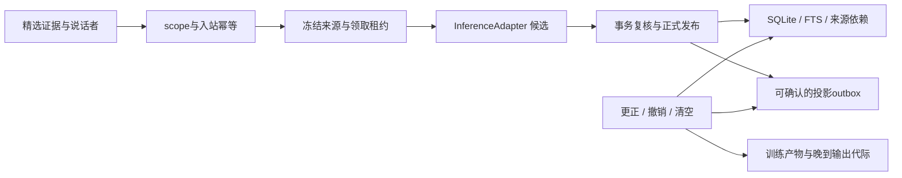

# Companion Core

[WF2 教师控制与小批验收](docs/WF2-VALIDATION.md)分列源码、原生调度、公开探针、真实教师与对应提交 CI。工程交付 `PARTIAL`；低 effort、HIGH2 和 medium 实际均已停止，合格数据0。Student 推理/训练未执行，教学数据保持私有。

[当前架构进度](docs/AEMC-DEVELOPMENT-STATUS.md)：IF0–IF11 的本机子集已进入 main，包括 [IF9 Store 物理压实](docs/CAPACITY-REPACK.md)（PR #5）、[IF10 Safety 终态冷段](docs/SAFETY-COLD-SEGMENT.md)（#6）、IF11 authority 有界永久冷路由（#12）；当前 generation fanout（#17）、E1a（#13）与 E1b（#16）也已合并。[PR #21](https://github.com/saigyujikingyo-png/companion-core/pull/21) 的 BCD/共享 raw HTTP/E2 TEXT Host 于2026-10-28合并为 `b58310c`（tree `c89ff674`，与1393项/strict/独审候选相同），push+PR 14/14 CI通过，合并后main 7/7 CI通过。E3a 为本次 [SINGLE_MESSAGE_CONTROL_PROTOTYPE](docs/ENDOGENOUS-LIFECYCLE.md) 候选，不是长期收件队列或真实 AgentAPI 部署。[长期容量](docs/LONG-TERM-CAPACITY-DESIGN.md)仍有整库RAM镜像、16MiB图、8192 Safety总数及authority四个不可复用槽等硬界；P5 Store冷镜像负成本实验暂停，未推广。既有成本/阴性证据保留；真实新provider/Host部署、跨机和训练没有由本轮合成验证取得接受。

[IF3/IF4 历史组合证据](docs/AEMC-INFRA-EVIDENCE-IF4.md)保留该旧源码的822/822、类型检查、独立审查与成本结果；[IF5/IF6 本机组合证据](docs/AEMC-INFRA-EVIDENCE-IF6.md)保留874/874及成本测量，后续提交与合并结果以 IF7 证据为准。本批未启动训练。

[AEMC训练前基础设施总矩阵](docs/AEMC-INFRASTRUCTURE.md)保留完整范围。[AnchoredVault](docs/ANCHORED-VAULT.md)实现独立外锚、恢复旧源 fencing、recipient rewrap 与 DEK rekey；[schema2 持久消费者](docs/DURABLE-FANOUT.md)提供两个独立元数据投影/进度和 TTL/代际屏障。新 [v3增量存储](docs/INCREMENTAL-STORAGE.md)采用固定块差分+Brotli4、单份密文和有界恢复链，支持保留旧源的新目标压实；[旧M2导入](docs/LEGACY-M2-IMPORT.md)保留账本/额度，以同外锚唯一来源登记和实际准入门防重。原 [M2隔离恢复](docs/M2-BACKUP.md)没有激活绕过，旧副本不受新外锚fence。均为有界本机实现，不代表远程托管、十年可靠性或训练准入。下方旧切片保留历史范围。

[WF1 私有教师校准](docs/WF1-CAMPAIGN.md)已实现独立有界 worker、持久调用消费、加密 custody、形式目标重算与 train/dev 评审的分账协议；当前源码仅经合成验证，真实执行另行准入。模型评审不等于形式证明或许可认证，Student 推理/训练仍 `NOT_RUN`，数据公开仍 `NOT_AUTHORIZED`。

[WF0 教学 metadata 合同](docs/WF0-TEACHING-CONTRACT.md)已实现有界版本化声明验证、同源家族/私有继承与切分检查及公开 metadata 投影；始终 `DECLARATION_VALID_ONLY / NOT_AUTHORIZED / NOT_AUTHENTICATED / NOT_EVALUATED`，不生成教学内容、不认证许可或真实推理，不接 provider、trainer 或 Store。[Together gpt-oss 教师补充](docs/GPT-OSS-TEACHER-RESEARCH.md)是 API 执行前的 **DESIGN_ONLY** 研究快照，未调用或验证质量。

可审计的本地联想记忆底座。云端 API 与未来本地模型共用来源、身份、检索、撤销和学习产物边界；桌宠、社交插件、移动端只是不同入口。

**当前是 0.1 开发原型：本轮验收仅合成数据，未迁移旧用户数据库。** 真实 provider 与宿主回合按独立证据验收，普通测试不会调用真实模型。它是现有六插件维护工作的独立实验核心；尚未替换、合并或发布到任一上游插件。

[目标决策](docs/TARGET-DECISIONS.md)明确：果蝇是可替换候选；Student v1 优先自然中文与陪伴质量，科学/工具/来源/执行真实性独立硬回归；通用公开底座与私有实例记忆/个性层分离。均为 **DESIGN_ONLY**，不变更既有实现验收。

**成长日记的产品目标是记录真实微调与持续学习训练履历，并以源码/OneDrive 外私有硬盘冷存储为权威**。[TJ0 离线磁盘协议](docs/TJ0-DISK-FORMAT.md)已实现有界合成声明 schema/reducer、identity/Zstd、跨进程回读与索引重建，始终 `NOT_AUTHENTICATED`；独立 [TJ1 Windows canary](docs/TJ1-CANARY.md)已完成一次 CPU 小 readout 的真实 64 步训练、导出、新进程 reload/独立 eval；它不是预训练/LLM 微调或通用训练服务。跨重开仅 `RECORDED_CLAIMS_ONLY / RECONCILE_REQUIRED`，激活未实现。见 [TrainingRun 设计与下一切片](docs/TRAINING-RUN-JOURNAL.md)：固定版本化格式支持后续专属无损压缩/解压研究，RAM 仅作近期缓存。当前 J0 尚未交付真实训练日记，不能回填不存在的训练历史。

[导师—教师—Student 工作流](docs/MENTOR-TEACHER-STUDENT-WORKFLOW.md)是 **DESIGN_ONLY** 的分阶段研究入口：职责隔离不自动满足防蒸馏条款，候选生成、许可、训练、质量、量化与激活各守独立门。

**当前 [J0 GrowthJournal](docs/GROWTH-JOURNAL.md)：** 有界 RAM 日记把计划、实际 curation lint/revalidate、终态与固定模拟训练四维分开记录。每次读取/导出复核原来源池；合法 runtime 变化可新绑历史视图，旧写入永久失效；撤销、同意代际变化、到期或时钟倒退不能靠重绑恢复。JSON/安全 Markdown 只是声明档案，不能自行认证执行或恢复能力。实际模型调用/训练为0，数据库schema1和M2不变；作者专项、独立审查、whole和CI分层验收。

[Q0 公开研究包](research/q0/README.md)保留独立正式实验及阴性结论：没有方法同时通过15%完整archive节省与冻结质量门。它是有限合成given-address表征回读，不是模型/感知/自然语言检索或生产证明；[portable replay](research/q0/REPLAY.md)默认只准备并核hash，full PUBLIC_REPLAY须显式运行。CI仅1公开family×6方法small smoke及prepare/hash检查，不跑600-family正式实验。

**当前 [SP0A / AR0b0](docs/SCENE-AUTHORITY.md)：** 新增受信 Store 来源绑定和最多8个 RAM 消费者的 reset/完整替换协议；每次数据读取/交付复核全部绑定来源、当前权限、TTL与时钟，暂停清除旧正文/投递句柄，撤销终止旧数据能力。显式 Scene logical v2承载真实0 epoch，v1原规则/黄金字节和数据库schema1保持不变。M2只恢复来源，Scene须新绑定、新reset及显式重新提供JSON。作者专项226/226、strict TS及零模型demo通过，独立审查/whole/提交CI另行验收。来源有效不等于claim事实正确；持久fanout仍[仅设计](docs/ADR-AR0B-DURABLE.md)，未接真实宿主、数据或部署。

**许可与公开边界：** 项目第一方代码、文档和合成测试采用 [Apache-2.0](LICENSE)；[第三方与数据边界](docs/THIRD-PARTY.md)单列。所有package仍保留 `private: true`，只防止误发npm，不限制本仓源码按Apache-2.0使用。源码与安全摘要不包含原始实验工件、凭据或本机部署环境；fresh clone可跑synthetic checks，不能仅clone后就复现原resident部署。

**此前陪伴窗口源码（2026-10-26）：** `05cbeeac9411af87081282ca43223d767eca09f3` 分离[observed presence与显式陪伴窗口](docs/PRESENCE-WINDOW.md)。窗口是通信permission，不是人在场证据；默认禁用，不修改state阈值、奖励或原生30秒观察租约。strict TS、300/300 tests、七步回放及独立Astra63项通过。[实际SDK窗口接线](docs/evidence/NATIVE-ACCEPTANCE.md#window-control)为 **WINDOW_CONTROL_WIRING_PASS**：真实synthetic Node child、1次合成provider/原生ACK、真实API0；grant60后原输入观测+31秒时available=false而window仍有效，重复grant不延期，off/pause/resume不恢复permission，child/outer均clean。它不是自然主动触发或UI体验验收，本批未部署生产。

[学习设计](docs/LEARNING-DESIGN.md)的 **L1.a 已实现 RAM 内声明 lint 与候选 manifest**：只读核对当前授权/来源、同源分组、时间切分及人工声明的冲突；其余训练、评测、激活、多模态和长job/大dataset路线仍为 **DESIGN_ONLY**。标注输入仍需人工或未来模型另行生成；linter 不识别语义真值、不验证翻译质量，也不授予训练许可。

**[AR0 当前召回](docs/AR0-RETRIEVAL.md)** 已实现 memory-only 有界 snapshot 与同版 RAM 字面/共享来源投影；普通读取与学习许可分离，每次 query/resolve 复核全部绑定来源，旧 epoch、撤销、到期或时钟倒退拒绝旧能力。作者专项 139/139、独立最终 6/6、本机一次 whole 413/413 与 strict TS/三个合成 demo 通过；原12项 L1 差量仅保留 TOOL_OUTPUT_ONLY 历史证据、未重跑，各层不相加。CI 以发布后对应提交的 Actions 为准，当前不预报通过；未接全局 outbox ACK、持久 fanout、BM25/embedding/PPR 或真实部署，召回质量仍 `NOT_EVALUATED`。

[AEMC v0.6 表征补充](docs/AEMC-V06-REPRESENTATION.md)的后续窄切片 [SP0/SF0](docs/SCENE-PACKET.md)已实现纯 RAM ScenePacket、固定概念/profile引用和可读自包含 JSON 交换：有界闭合解析、claim 对象/角色绑定、完整 envelope 预算及长度/hash校验。它仅验证声明一致性，始终标记 `NOT_AUTHENTICATED`；真实来源权限、感知、3D、residual decoder、压缩和质量实验均未实现。研究协议其余部分保持 DESIGN_ONLY / EXPERIMENT_NOT_RUN；本批作者专项33/33与独立最终返验通过，whole/CI以本批回执及对应提交Actions为准，当前不预报通过。

**上一主动交接源码（2026-10-26）：** `4e3f246b5a7f0ce7ecbae9b8822d687096aa779b` 修复[主动投递与前台交接](docs/DSH-COUPLED.md)：ready在原生回合/ACK等待期间有界保留，原生完成且core ACK落定后，经受原租约约束的SDK `whenIdle()`再发布；新鲜人类输入停止旧调度，只有最新输入的成功ACK可按原到期时间重新调度。前台等待实际逻辑工作及raw permits清空后才领取入站/额度，暂停、撤销或到期拒绝等待，不轮询、不重试、不延长租约。作者strict TypeScript、272/272合成测试和七步回放PASS；独立Astra max 39项定向检查PASS。[实际SDK零真实API投递](docs/evidence/NATIVE-ACCEPTANCE.md#proactive-zero)已 **ZERO_NATIVE_DELIVERY_PASS**：fixture验证ready排队/单次消费及两个native ACK，未构造真实core/memory/HTTP。

[唯一自然时间试验](docs/evidence/NATIVE-ACCEPTANCE.md#proactive-natural)为 **NO_TRIGGER**：新源码、fresh M2单次boot下，约120秒内五次固定合成自述均获真实DeepSeek回复及native completed ACK，主动ready/送达0；reserve5/6、unknown0，暂停后重复同RPC没有新回合/调用，内外清理exit0/noForce/owned0。第六次封存、不退款或重试。此为有效阴性，既非传输失败，也非自然主动闭环或产品可用PASS；未直接暴露的shadow intent不据此判定不存在。新源码跨重启未重测，下面保留此前M2实际两次恢复证据。`4e3f246`及本批`05cbeea`均未部署，原部署回执proactive=false；本批未变更生产，当前状态/用量未重读。

**已验收M2版本（2026-10-26）：** [M2a 加密跨重启记忆](docs/M2-DURABLE.md)当时源码冻结于 `25cb0f8c6073dc91167c2507d9444a5500b560a7`；strict TypeScript、241/241 合成测试和七步回放通过，独立 Astra max 的八项定向返验通过。修复将 SQLite FTS5 完整 RAM COMMIT 放在序列化之前，随后完成加密检查点和独立安全账本提交才返回成功；不确定失败会封锁整个 store/vault。旧失败测试库封存、未解密；FTS缺陷由独立完整序列红绿复现确认，已知损坏检查点不会自动修复或接受。

原 `newcap8` 真实 DeepSeek/DSH 切片中 A/B/C/D 四次请求均有 native ACK；状态先验、下一输入消费显式反馈、暂停拒绝、首次恢复召回和 SDK 重复 RPC 抑制有局部证据。但撤销后的第二次恢复失败，E 未发送，故原链保留 PARTIAL。修复后独立新 vault 的0 API凭据/0模型调用原生检查，以及新 cap3 的 A→重启 B 召回→撤销 A→重启 C 排除均已通过；[三请求原生证据](docs/evidence/NATIVE-ACCEPTANCE.md#m2-repaired-three-call)与[验证记录](docs/VALIDATION.md)保留分层结论。两批不是同一 vault 的连续 A→E；原4+新3合计7次已ACK、共享aggregate8上限，不退款、不重试。

此前 M2 桌面部署回执为 **READY，UI_CONTROL_PENDING**：bootstrap创建并flush后干净卸载，同vault/identity以resume-only挂载；回执当时0/32、baseline、paused=true、available=false，未发送生产prompt。通过会话行菜单“打开 Companion Core 会话”进入其配置的专用SID，先执行 `/companion-resume`；命令不调用模型或授予在场租约，新输入才提供短租约。该阶段新菜单实际点击回执/聊天输入框绑定待确认，不能复用旧SID的UI PASS。见[部署与用法](docs/evidence/NATIVE-ACCEPTANCE.md#m2-desktop)和[部署回执](docs/evidence/NATIVE-ACCEPTANCE.md#m2-desktop)。神经切换接口保留，M2+flywire原生组合未在本轮验证。

以上证明机制与合成文字经过真实模型/宿主的有限链路，不证明自然交流品质、永久情感或意识。背景/神经状态在恢复时重置；`enableProactive:false` 的验收不证明主动投递。M2a 的同机恢复也不等于备份迁移、长期规模或十年可靠性；独立 `authority.sqlite` 被回滚到有效前缀仍为 `KNOWN_UNPROTECTED_LEDGER_ROLLBACK`。

**历史 RAM 部署快照（2026-10-25）：** [双向状态/回忆/交流](docs/COUPLED-RUNTIME.md)与[受信 stdio 宿主入口](docs/COUPLED-STDIO.md)曾通过完整143项回归、真实DeepSeek有限闭环、真实FlyWire CPU在线接口及Windows stdio stop/EOF独立验收；[证据与限制](docs/evidence/NATIVE-ACCEPTANCE.md#coupled-core-ram)保留失败案例。该快照仅RAM，当时未完成M2；DSH rc.3 专用插件会话实际 READY，用户确认成功打开，whole187/187 与后续 client5/5 分开记录。切换前fresh safe audit/PID确认旧常驻0/32且paused；现旧后台和客户端已卸载、旧子进程全部干净退出，原文件/claim/审计保留，DSH主进程未重启。

[DSH 挂载原型](docs/DSH-COUPLED.md)当前每个原生回合只支持一条纯文本输入；多模态和合并连续输入尚未支持，请避免连续拆条。宿主同轮合并多条人类消息时会明确拒绝整批，不静默只处理最后一条。
当前 `revoke/purge` 会使绑定失效并暂停；本批证明重新挂载/重启同一修复库后撤销仍生效，不提供撤销后当前绑定自动继续聊天。公共控制命令没有自动 create/reset fallback，后续需改善控制面。
旧 RAM 快照的 DSH 原生只读状态为 **CONTROL_PASS**：用户看见固定SID的真实状态回执，独立safe audit有2条command-status，当时模型计数0/32；[分层证据](docs/evidence/NATIVE-ACCEPTANCE.md#dsh-control-ram)。该历史回执不能替代新 M2 会话的 UI_CONTROL_PENDING。

## 运行

使用 Node **24.16.0 / 24.x**。运行本身没有第三方依赖；类型检查的开发依赖已固定并带 lockfile。

```powershell
npm ci --ignore-scripts
npm run check
```

`check` 执行严格 TypeScript 检查、SQLite 合成回归和端到端合成回放。单独 `npm run demo` 会在系统临时目录创建一个全新的数据库，打印路径并保留供检查，不读取现有文件。演示不需要 API key、GPU、摄像头或麦克风。

运行 `npm run demo:curation` 可复现 L1.a 的固定合成声明检查。它仅使用全新 RAM 数据库，输出 counts/codes、`CURATION_LINT_PASS` 与质量 `NOT_EVALUATED`；不输出原文、来源身份、manifest digest，也不训练或调用 API。`check` 在原有回放之后运行此演示。候选包含私有正文，仅供受信代码在 RAM 中审阅，使用时必须再次验证；参见[实际 L1.a 接口与限制](docs/LEARNING-DESIGN.md#l1a-已实现的窄接口)。

`npm run demo:retrieval` 演示 AR0 的直接/共享来源命中与撤销后拒绝，输出 `AR0_CONTRACT_PASS`、counts/codes 和质量 `NOT_EVALUATED`；仅新建 RAM 数据库，零 API，不打印正文或身份。`check` 将它追加在 curation 演示之后。真实使用跨 `await` 或送入 provider 前须再次 `resolve`，已经交出的副本不能物理召回。

`npm run demo:scene` 演示独立 SP0/SF0 合成声明往返；输出 `SCENE_CONTRACT_PASS` 与 `PERCEPTION_NOT_RUN`、`SEMANTIC_QUALITY_NOT_EVALUATED`、`PRODUCTION_NOT_CONNECTED`。`check` 将它追加在 retrieval demo 之后；不打开数据库、读取媒体或调用模型。随后 `demo:scene-authority` 新建合成 RAM Store，验证双消费者和撤销清除，输出 `SCENE_AUTHORITY_PASS`；无模型调用、持久consumer或生产连接。

`npm run demo:journal` 实际运行一次合成来源的 curation lint/revalidate，再回放七种明确标记的模拟场景；输出 `GROWTH_JOURNAL_PASS`、0训练/0模型与两个新建系统临时文件路径（JSON及安全Markdown，保留供检查）。档案重开仍为 `NOT_AUTHENTICATED`；不恢复受信日记。`check` 在此演示后仅追加Q0 small smoke和prepare/hash检查，不执行600-family正式实验。

## 已实现的切片



- 四维 scope：租户、主体、角色、关系；M1 受信绑定冻结身份和代际，调用方负责宿主认证与证据选择授权。
- 精选文字证据和事件键幂等；不录制音视频。原始事件键与正文去重用库内密钥 HMAC，墓碑只留元数据。
- 在异步提取之前冻结来源 revision；租约由核心生成，单调时间计时；到期、接管、重启、撤销均阻止旧结果提交。
- 候选来源、说话者、推断/自述及 TTL 验证；发布和 outbox 同一事务；失败不会返回保存成功。
- 来源 DAG 更正/撤销、scope 清空、缓存命中重新验权威记录；FTS 与中文子串召回不截断为“最近 500 条”。
- 投影消费者获取 upsert/remove 并确认；周期调用可产生未来生效/到期变化。它是至少一次协议，不声称远端恰好一次。
- 可选训练注册表绑定许可与删除代际；子检查点继承父产物来源；激活和每次输出交付前检查运行代际。此处**没有训练或加载模型**。
- M1 版本化 JSON 边界、DSH/Codex 精选文字映射、持久提取幂等、有界队列与立即本地取消；云 HTTPS/本地回环共用可注入 HTTP 推理适配器。
- 本地神经能力策略默认小回路，分别检查推理、局部学习、读出训练和回路反向传播的实测证据；按工作负载、检查点、设备和运行时版本失效，支持已验证的 CPU 回退。独立 Python/CUDA 研究 CLI 与有限 CPU 在线 JSONL worker 分别验收，见[耦合运行时](docs/COUPLED-RUNTIME.md)；不是通用神经模型服务。
- 非语言背景状态的独立影子切片：解析快慢状态、交流/退避动机、情境门控和下一次检查时间；解释假设与实际反馈分开，按原始事件去重，删除或迟到不能复活旧影响。该独立切片不自行调用模型或发言；耦合器按宿主许可单次消费意图，没有默认常驻定时器。
- Host、Inference、Media、Neural、Action 的扩展接口；Media/Action 的在线服务仍待实施，Neural 仅有上述有限 CPU 接口。真实 DeepSeek 与 Codex 回合已按独立证据验收，神经实验的具体完成范围见实验记录。

## 阅读入口

| 文件 | 用途 |
|---|---|
| [核心契约](docs/CONTRACTS.md) | 生命周期、错误、信任边界、时序 |
| [实施路线](docs/ROADMAP.md) | 开发顺序、验收门槛、上游接入 |
| [维护约定](docs/MAINTENANCE.md) | 数据、版本、CI、发布、回滚与分工 |
| [设计决策](docs/ADR-0001-authority.md) | 为什么从独立权威核心起步 |
| [验证记录](docs/VALIDATION.md) | 实际通过与未执行范围 |
| [M1 适配合同](docs/M1-ADAPTERS.md) | 宿主绑定、协议映射、取消、背压与 HTTP |
| [Codex 原生验收](docs/CODEX-NATIVE-ACCEPTANCE.md) | 真实完成回合、合成记忆落库、独立中断及保留的重放失败 |
| [本地回路策略](docs/NEURAL-LOCAL-POLICY.md) | 本地优先、能力证据、训练资格与硬件回退 |
| [连接组实验](docs/M4-NEURAL-LAB.md) | 冻结真实子图、CUDA研究CLI、局部学习与训练对照；以实际run状态为准 |
| [背景状态实验](docs/BACKGROUND-STATE.md) | 跨事件状态、影子动机、来源去重、解析空闲推进与可替换后端边界 |
| [安全边界](SECURITY.md) | 原型限制与真实数据接入门槛 |

## 当前边界

本机临时库测试不能证明十年可靠性。当前提供薄宿主映射、HTTP 客户端、实验性背景状态层和可选 M2a 加密存储，没有对外认证网络服务、备份恢复命令、条件偏好解析、多端同步、语义向量或经过自然交互评测的情感系统；这些均在路线图中。`MemoryStore` 是可信单一权威进程的内部接口，不能直接开放给不可信插件或公网。内容验证不能证明模型提取语义正确，信任的 Host 仍须绑定说话者并选择证据。

`purge/revoke` 实现逻辑撤销与当前表/FTS 清除，不承诺 RAM、WAL 历史页、旧快照、SSD 介质或供应商已接收数据立即物理擦除。用户已授权有限个人试用常驻；面向长期生产运维仍需备份恢复、迁移与规模验证，当前有限容量原型不提供十年保证。

本仓第一方实现按 [Apache-2.0](LICENSE) 发布；项目地址为 [companion-core](https://github.com/saigyujikingyo-png/companion-core)。参考研究与历史实验工件仍在本地独立保留；它们及第三方SDK、数据、模型权重不因本仓许可而重新授权。`private: true` 继续防止意外npm发布。
