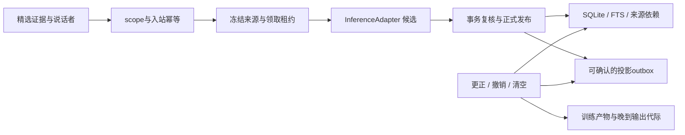

# Companion Core

可审计的本地联想记忆底座。云端 API 与未来本地模型共用来源、身份、检索、撤销和学习产物边界；桌宠、社交插件、移动端只是不同入口。

**当前是 0.1 开发原型：运行合成数据，不接生产数据库。** 真实 provider 与宿主回合按独立证据验收，普通测试不会调用真实模型。它是现有六插件维护工作的独立实验核心；尚未替换、合并或发布到任一上游插件。

## 运行

使用 Node **24.16.0 / 24.x**。运行本身没有第三方依赖；类型检查的开发依赖已固定并带 lockfile。

```powershell
npm ci --ignore-scripts
npm run check
```

`check` 执行严格 TypeScript 检查、SQLite 合成回归和端到端合成回放。单独 `npm run demo` 会在系统临时目录创建一个全新的数据库，打印路径并保留供检查，不读取现有文件。演示不需要 API key、GPU、摄像头或麦克风。

## 已实现的切片



- 四维 scope：租户、主体、角色、关系；M1 受信绑定冻结身份和代际，调用方负责宿主认证与证据选择授权。
- 精选文字证据和事件键幂等；不录制音视频。原始事件键与正文去重用库内密钥 HMAC，墓碑只留元数据。
- 在异步提取之前冻结来源 revision；租约由核心生成，单调时间计时；到期、接管、重启、撤销均阻止旧结果提交。
- 候选来源、说话者、推断/自述及 TTL 验证；发布和 outbox 同一事务；失败不会返回保存成功。
- 来源 DAG 更正/撤销、scope 清空、缓存命中重新验权威记录；FTS 与中文子串召回不截断为“最近 500 条”。
- 投影消费者获取 upsert/remove 并确认；周期调用可产生未来生效/到期变化。它是至少一次协议，不声称远端恰好一次。
- 可选训练注册表绑定许可与删除代际；子检查点继承父产物来源；激活和每次输出交付前检查运行代际。此处**没有训练或加载模型**。
- M1 版本化 JSON 边界、DSH/Codex 精选文字映射、持久提取幂等、有界队列与立即本地取消；云 HTTPS/本地回环共用可注入 HTTP 推理适配器。
- 本地神经能力策略默认小回路，分别检查推理、局部学习、读出训练和全回路反向传播的实测证据；按工作负载、检查点、设备和运行时版本失效，支持已验证的 CPU 回退。尚无实际神经后端。
- Host、Inference、Media、Neural、Action 的扩展接口；Media/Neural/Action 仍是接口，没有声称真实模型或神经回路运行。

## 阅读入口

| 文件 | 用途 |
|---|---|
| [核心契约](docs/CONTRACTS.md) | 生命周期、错误、信任边界、时序 |
| [实施路线](docs/ROADMAP.md) | 开发顺序、验收门槛、上游接入 |
| [维护约定](docs/MAINTENANCE.md) | 数据、版本、CI、发布、回滚与分工 |
| [设计决策](docs/ADR-0001-authority.md) | 为什么从独立权威核心起步 |
| [验证记录](docs/VALIDATION.md) | 实际通过与未执行范围 |
| [M1 适配合同](docs/M1-ADAPTERS.md) | 宿主绑定、协议映射、取消、背压与 HTTP |
| [Codex 原生验收](docs/CODEX-NATIVE-ACCEPTANCE.md) | 真实完成回合、合成记忆落库、独立中断及保留的重放失败 |
| [本地回路策略](docs/NEURAL-LOCAL-POLICY.md) | 本地优先、能力证据、训练资格与硬件回退 |
| [安全边界](SECURITY.md) | 原型限制与真实数据接入门槛 |

## 当前边界

本机临时库测试不能证明十年可靠性。当前提供薄宿主映射与 HTTP 客户端，没有对外认证网络服务、加密存储、备份恢复命令、条件偏好解析、多端同步、语义向量或情感模型；这些均在路线图中。`MemoryStore` 是可信单一权威进程的内部接口，不能直接开放给不可信插件或公网。内容验证不能证明模型提取语义正确，信任的 Host 仍须绑定说话者并选择证据。

`purge/revoke` 实现逻辑撤销与当前表/FTS 清除，不承诺 RAM、WAL 历史页、旧快照、SSD 介质或供应商已接收数据立即物理擦除。真实数据上线前必须完成加密、快照、撤销账本恢复和输出取消验收。

本仓使用原创实现，参考研究保留在同级 `dsh-plugin-maintenance/research/2026-10-25-architecture`。尚未选择公开分发许可或创建远端；`private: true` 防止意外 npm 发布。
