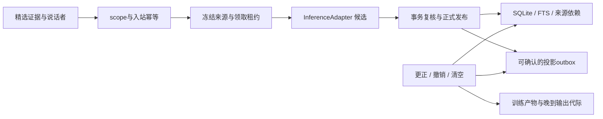

# Companion Core

可审计的本地联想记忆底座。云端 API 与未来本地模型共用来源、身份、检索、撤销和学习产物边界；桌宠、社交插件、移动端只是不同入口。

**当前是 0.1 开发原型：本轮验收仅合成数据，未迁移旧用户数据库。** 真实 provider 与宿主回合按独立证据验收，普通测试不会调用真实模型。它是现有六插件维护工作的独立实验核心；尚未替换、合并或发布到任一上游插件。

**最新状态（2026-10-26）：** [M2a 加密跨重启记忆](docs/M2-DURABLE.md)源码冻结于 `25cb0f8c6073dc91167c2507d9444a5500b560a7`；strict TypeScript、241/241 合成测试和七步回放通过，独立 Astra max 的八项定向返验通过。修复将 SQLite FTS5 完整 RAM COMMIT 放在序列化之前，随后完成加密检查点和独立安全账本提交才返回成功；不确定失败会封锁整个 store/vault。旧失败测试库封存、未解密；FTS缺陷由独立完整序列红绿复现确认，已知损坏检查点不会自动修复或接受。

原 `newcap8` 真实 DeepSeek/DSH 切片中 A/B/C/D 四次请求均有 native ACK；状态先验、下一输入消费显式反馈、暂停拒绝、首次恢复召回和 SDK 重复 RPC 抑制有局部证据。但撤销后的第二次恢复失败，E 未发送，故原链保留 PARTIAL。修复后独立新 vault 的0 API凭据/0模型调用原生检查，以及新 cap3 的 A→重启 B 召回→撤销 A→重启 C 排除均已通过；[三请求原生证据](../dsh-plugin-maintenance/research/2026-10-25-memory-recovery/REPAIRED-REAL-PASS.json)与[验证记录](docs/VALIDATION.md)保留分层结论。两批不是同一 vault 的连续 A→E；原4+新3合计7次已ACK、共享aggregate8上限，不退款、不重试。

新 M2 桌面常驻已 **READY，UI_CONTROL_PENDING**：bootstrap创建并flush后干净卸载，最终同vault/identity以resume-only挂载；0/32、baseline、paused=true、available=false，未发送生产prompt。通过会话行菜单“打开 Companion Core 会话”进入新SID `37f962f8-5a4c-4cc5-8b44-f28bcdebf886`，先执行 `/companion-resume`；命令不调用模型或授予在场租约，新输入才提供短租约。新菜单实际点击回执/聊天输入框绑定仍待确认，不能复用旧SID的UI PASS。见[部署与用法](../dsh-plugin-maintenance/research/2026-10-25-memory-recovery/DEPLOYMENT.md)和[部署回执](../dsh-plugin-maintenance/research/2026-10-25-memory-recovery/DEPLOYMENT-PASS.json)。神经切换接口保留，M2+flywire原生组合本轮未测。

以上证明机制与合成文字经过真实模型/宿主的有限链路，不证明自然交流品质、永久情感或意识。背景/神经状态在恢复时重置；`enableProactive:false` 的验收不证明主动投递。M2a 的同机恢复也不等于备份迁移、长期规模或十年可靠性；独立 `authority.sqlite` 被回滚到有效前缀仍为 `KNOWN_UNPROTECTED_LEDGER_ROLLBACK`。

**历史 RAM 部署快照（2026-10-25）：** [双向状态/回忆/交流](docs/COUPLED-RUNTIME.md)与[受信 stdio 宿主入口](docs/COUPLED-STDIO.md)曾通过完整143项回归、真实DeepSeek有限闭环、真实FlyWire CPU在线接口及Windows stdio stop/EOF独立验收；[证据与限制](../dsh-plugin-maintenance/research/2026-10-25-coupling/README.md)保留失败案例。该快照仅RAM，当时未完成M2；DSH rc.3 专用插件会话实际 READY，用户确认成功打开，whole187/187 与后续 client5/5 分开记录。切换前fresh safe audit/PID确认旧常驻0/32且paused；现旧后台和客户端已卸载、旧子进程全部干净退出，原文件/claim/审计保留，DSH主进程未重启。

[DSH 挂载原型](docs/DSH-COUPLED.md)当前每个原生回合只支持一条纯文本输入；多模态和合并连续输入尚未支持，请避免连续拆条。宿主同轮合并多条人类消息时会明确拒绝整批，不静默只处理最后一条。
当前 `revoke/purge` 会使绑定失效并暂停；本批证明重新挂载/重启同一修复库后撤销仍生效，不提供撤销后当前绑定自动继续聊天。公共控制命令没有自动 create/reset fallback，后续需改善控制面。
旧 RAM 快照的 DSH 原生只读状态为 **CONTROL_PASS**：用户看见固定SID的真实状态回执，独立safe audit有2条command-status，当时模型计数0/32；[分层证据](../dsh-plugin-maintenance/research/2026-10-25-coupling/DSH-CONTROL-PASS.json)。该历史回执不能替代新 M2 会话的 UI_CONTROL_PENDING。

## 运行

使用 Node **24.16.0 / 24.x**。运行本身没有第三方依赖；类型检查的开发依赖已固定并带 lockfile。

```powershell
npm ci --ignore-scripts
npm run check
```

`check` 执行严格 TypeScript 检查、SQLite 合成回归和端到端合成回放。单独 `npm run demo` 会在系统临时目录创建一个全新的数据库，打印路径并保留供检查，不读取现有文件。演示不需要 API key、GPU、摄像头或麦克风。

## 已实现的切片



- 四维 scope：租户、主体、角色、关系；M1 受信绑定冻结身份和代际，调用方负责宿主认证与证据选择授权。
- 精选文字证据和事件键幂等；不录制音视频。原始事件键与正文去重用库内密钥 HMAC，墓碑只留元数据。
- 在异步提取之前冻结来源 revision；租约由核心生成，单调时间计时；到期、接管、重启、撤销均阻止旧结果提交。
- 候选来源、说话者、推断/自述及 TTL 验证；发布和 outbox 同一事务；失败不会返回保存成功。
- 来源 DAG 更正/撤销、scope 清空、缓存命中重新验权威记录；FTS 与中文子串召回不截断为“最近 500 条”。
- 投影消费者获取 upsert/remove 并确认；周期调用可产生未来生效/到期变化。它是至少一次协议，不声称远端恰好一次。
- 可选训练注册表绑定许可与删除代际；子检查点继承父产物来源；激活和每次输出交付前检查运行代际。此处**没有训练或加载模型**。
- M1 版本化 JSON 边界、DSH/Codex 精选文字映射、持久提取幂等、有界队列与立即本地取消；云 HTTPS/本地回环共用可注入 HTTP 推理适配器。
- 本地神经能力策略默认小回路，分别检查推理、局部学习、读出训练和回路反向传播的实测证据；按工作负载、检查点、设备和运行时版本失效，支持已验证的 CPU 回退。独立 Python/CUDA 研究 CLI 与有限 CPU 在线 JSONL worker 分别验收，见[耦合运行时](docs/COUPLED-RUNTIME.md)；不是通用神经模型服务。
- 非语言背景状态的独立影子切片：解析快慢状态、交流/退避动机、情境门控和下一次检查时间；解释假设与实际反馈分开，按原始事件去重，删除或迟到不能复活旧影响。该独立切片不自行调用模型或发言；耦合器按宿主许可单次消费意图，没有默认常驻定时器。
- Host、Inference、Media、Neural、Action 的扩展接口；Media/Action 的在线服务仍待实施，Neural 仅有上述有限 CPU 接口。真实 DeepSeek 与 Codex 回合已按独立证据验收，神经实验的具体完成范围见实验记录。

## 阅读入口

| 文件 | 用途 |
|---|---|
| [核心契约](docs/CONTRACTS.md) | 生命周期、错误、信任边界、时序 |
| [实施路线](docs/ROADMAP.md) | 开发顺序、验收门槛、上游接入 |
| [维护约定](docs/MAINTENANCE.md) | 数据、版本、CI、发布、回滚与分工 |
| [设计决策](docs/ADR-0001-authority.md) | 为什么从独立权威核心起步 |
| [验证记录](docs/VALIDATION.md) | 实际通过与未执行范围 |
| [M1 适配合同](docs/M1-ADAPTERS.md) | 宿主绑定、协议映射、取消、背压与 HTTP |
| [Codex 原生验收](docs/CODEX-NATIVE-ACCEPTANCE.md) | 真实完成回合、合成记忆落库、独立中断及保留的重放失败 |
| [本地回路策略](docs/NEURAL-LOCAL-POLICY.md) | 本地优先、能力证据、训练资格与硬件回退 |
| [连接组实验](docs/M4-NEURAL-LAB.md) | 冻结真实子图、CUDA研究CLI、局部学习与训练对照；以实际run状态为准 |
| [背景状态实验](docs/BACKGROUND-STATE.md) | 跨事件状态、影子动机、来源去重、解析空闲推进与可替换后端边界 |
| [安全边界](SECURITY.md) | 原型限制与真实数据接入门槛 |

## 当前边界

本机临时库测试不能证明十年可靠性。当前提供薄宿主映射、HTTP 客户端、实验性背景状态层和可选 M2a 加密存储，没有对外认证网络服务、备份恢复命令、条件偏好解析、多端同步、语义向量或经过自然交互评测的情感系统；这些均在路线图中。`MemoryStore` 是可信单一权威进程的内部接口，不能直接开放给不可信插件或公网。内容验证不能证明模型提取语义正确，信任的 Host 仍须绑定说话者并选择证据。

`purge/revoke` 实现逻辑撤销与当前表/FTS 清除，不承诺 RAM、WAL 历史页、旧快照、SSD 介质或供应商已接收数据立即物理擦除。用户已授权有限个人试用常驻；面向长期生产运维仍需备份恢复、迁移与规模验证，当前有限容量原型不提供十年保证。

本仓使用原创实现，参考研究保留在同级 `dsh-plugin-maintenance/research/2026-10-25-architecture`。尚未选择公开分发许可或创建远端；`private: true` 防止意外 npm 发布。
