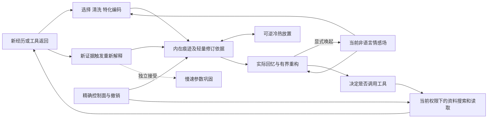

# 内在痕迹、外部工具资料与精确控制面的边界

2026-10-27。**架构方向采用；新合同与认知实现 DESIGN_ONLY / EXPERIMENT_NOT_RUN**。Root 已读侧边完整评估及固定 GitHub 来源清单，核对两份 SHA，并据当前存储合同作此决议。它澄清 I01/I03/I04/I06/I07/I09/I10/I12/I17，不改变18项接受分类，不修改原总纲、旧Q0阴性或 IF8/IF9 冻结合同。

## 三个职责域

| 域 | 保存和执行什么 | 约束 |
| --- | --- | --- |
| 内在痕迹 | 清洗、特征化、结构化、按类型编码的情景、对象、关系、概念与非语言情感片段；可有损、变热、重新解释与再编码 | 长期载荷不以原照片、录音、笔记或PDF字节作隐蔽备份；profile、来源、缺失和不确定性明确 |
| 外部工具资料 | 原文件、工具索引与当前访问能力；主动搜索、打开、核对原句或发送 | 记得位置线索不等于当前可访问；工具拒绝、文件不存在与记忆缺失分开 |
| 精确运行控制 | 幂等键、指纹、UNKNOWN、delivery、额度/反馈、撤销、可信head、提交与恢复记录 | 不有损、不靠遗忘恢复额度；维护和编码必须保留原安全语义 |

这些是逻辑与能力边界，不要求三台机器或三种数据库。权重之外的数据库仍可属于内在记忆；论文中的 external memory 不自动等于本项目的工具档案。缓存、NVMe、HDD决定物理放置/热度；参数巩固是独立学习维度。未量化KV也是模型中间表示，不是原PDF的逐字节副本。

## 与当前代码的关系

IF8无损回执与IF9 Store镜像压实/Safety载体服务持久化完整性；其中“保留原件”指保留迁移前的旧加密源和证据，不要求内在认知永久保留感知原媒体。IF9仍精确保留所接收的整个现有镜像，不会顺便清洗或改写正文。当前 MemoryStore 的 evidence/statement 与 Scene 声明是已有接口，**不是已实现的新 MemoryTrace/ToolRecordRef 边界**；禁止仅改文档就宣称新载荷隔离完成，也不就地迁移历史数据。

认知修订可更改有损载荷与解释，但必须继续复核当前来源权利、撤销及祖先闭包。允许丢弃旧高维载荷，不等于可删除控制墓碑、让旧能力复活或把旧解释伪装为当时观察。事件时间与重新理解时间分账。记忆重复唤起可以增加热度，不作为多份独立事实证据。

## 最小合同与后续实现切片

以下是待冻结的接口草案，不是新增运行时API：

- `MemoryTrace`：版本、类型、codec/profile、来源/用途、事件及对象关系、特征载荷、缺失/不确定性；不接受任意原文件嵌入。每种类型须有闭合形状和完整预算。
- `ToolRecordRef`：曾保存的主题、模糊标题/时间/位置线索、可选对象ID；不携带永久访问许可，且不是回忆存在的必需条件。
- `AffectTrace`：时间段、后端/profile、状态特征与转折、关联和质量；不预设生物/非生物后端、固定维数或六类情绪。
- `MemoryRevision`：新经历/证据、事件时间、解释时间、主要变化和版本依据；不要求无限保留全部旧高维载荷。
- 分开 `inspect/维护/预取`、`recall activation`、`reconsolidation`；仅实际唤起才进入受限情感耦合，后台校验不得因读库驱动状态。

最小纵向切片采用独立工作树、合成输入和可解释的小状态：PDF双路径 → 痕迹/情感片段 → 有界唤起 → 新经历编辑 → 冷热往返及跨重启，与[I17有限候选合同](BAYESIAN-RECONSTRUCTION-DESIGN.md)接合。它无需等待长期容量完全解决；先冻结输入形状、总字节/计算预算、失真与稳定性门，再实现，不在IF9源码冻结后夹入新功能或启动训练。

PDF验收例：能回忆大概标题/主题、何时为何制作、思路、感受、前因后果和曾存Drive的线索；普通回忆的原件访问次数为0。核对原句、读取或发送必须产生明确工具动作。文件移动/缺失、工具拒绝、标题模糊分开测试；不得伪造字节或从受控evaluator偷取真值来修复回忆。

同预算实验至少区分：静态记忆/仅热度变化/新经历触发修订，以及无耦合/单向/双向情感耦合。重复唤起与独立新经历分开，检查无新输入下的反馈放大；同profile测轨迹失真，跨后端比较功能，不直接比异坐标潜变量。热度、事实置信、情感强度、可核验性分别计量；损坏/profile不兼容明确失败，不偷偷读取原媒体补全。现有控制面拒绝与旧Q0门保持。

## 研究依据与采用边界

[CoALA](https://arxiv.org/abs/2309.02427)提供模块化记忆和内外动作空间的框架；这里的文件域划分是项目设计取舍，不是论文唯一结论。[Sims的率失真研究](https://pubmed.ncbi.nlm.nih.gov/27107330/)支持把有限容量与任务误差成本联结，但没有证明本项目长期多模态收益。[Nader等的再巩固实验](https://pubmed.ncbi.nlm.nih.gov/10963596/)限于特定恐惧记忆任务，不能推出每次回忆都须改写。情感片段压缩与双向耦合的具体效果仍待实验；Root本次PMC入口遇校验，相关情绪论文细节仅沿用侧边定向阅读，不冒称独立全文复核。

侧边已读的 [A-MEM固定实现](https://github.com/agiresearch/A-mem/blob/ceffb860f0712bbae97b184d440df62bc910ca8d/agentic_memory/memory_system.py#L590)可借鉴新经历更新旧note解释；[Generative Agents固定检索](https://github.com/joonspk-research/generative_agents/blob/fe05a71d3e4ed7d10bf68aa4eda6dd995ec070f4/reverie/backend_server/persona/cognitive_modules/retrieve.py#L199)可作访问热度基线。Root未重复审计两仓全部源码。Graphiti仅借鉴时序关系，不能原样采用其原始episode保留作为内在载荷；EnCodec/Mimi/ConceptGraphs仅列codec/对象表征候选。没有安装依赖、下载权重、完整许可审计或复现，不记为采用PASS。

侧边交付留存标识：`aemc-memory-boundary-review-20261027.md` SHA256 `090b216611df0788eb886381d5dc86a77290e17bb8996a092f7afb0f087cface`；七仓固定commit/README blob及阅读深度清单 `aemc-memory-boundary-sources-20261027.json` SHA256 `6da83b8329453b33d886413b88f8f85c1c8d54bb5aa22aa79b7f9cc397d482cb`。二者保持在侧边原目录，精确路径记在本机交接；不复制原研究资料进公开仓库。
