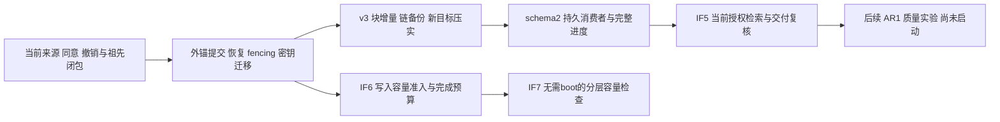

# AEMC 开发状态、架构取舍与发布进度

2026-10-27。IF0–IF6 已按用户确认的条件经 [PR #1](https://github.com/saigyujikingyo-png/companion-core/pull/1) 合并，`main` 合并点为 `06fc8b2265aec5fcba8cb851ac55a14326a99e22`，合并前后四平台 CI 通过。IF7 在此基线上另建 `codex/aemc-capacity-inspection-20261027`，已完成实现、作者验证、两位独立审查及一次独立893/893/TS验证；当前为 **LOCAL_VERIFIED / UNCOMMITTED / UNMERGED**。完整目标仍 **IN_PROGRESS / TRAINING_NOT_ADMITTED**，不计算混合完成率。

## 已落地的能力链

| 层 | 实际实现 | 仍不能推导的结论 |
|---|---|---|
| 来源与当前权限 | Store scope/consent/runtime、精确来源与完整祖先、撤销/过期复核 | 跨设备身份认证、真实素材使用权、事实语义为真 |
| IF0–IF2 存储与消费者 | M2隔离恢复、独立本机外锚、PREPARED/reconcile、旧anchored源fencing、KEK rewrap/DEK rekey、schema2双metadata消费者 | 生产custody、硬件防共同回滚、全局外部索引、十年容量 |
| IF3–IF4 热存储与导入 | 4096字节块replacement/XOR+Brotli4/raw、单blob、有界恢复链、保原密文备份、新目标compaction；M2冻结包导入、lineage防重和实际准入门 | 物理磁盘写次数、历史GC、旧M2副本fencing、真实私有库迁移 |
| IF5 / AR0b1 检索接线 | 完整durable projection在同一guard/冻结时间内与正文及祖先匹配；bind/refresh/query/resolve均复核消费者进度；过预算全拒绝 | 新排名算法、真实embedding/BM25/PPR、多跳或语言质量提升、宿主已接线 |
| IF6 容量失败处理 | 新PREPARED前预演最终化与日志预算；单pending全局新写门；捕获mutation异常也不能提交部分状态 | OS磁盘空间预分配、无限容量、全部旧异常pending可恢复、混跑旧writer安全 |
| IF7 容量观测 | 同authority guard读取exact head；不boot、不扫TTL、不改额度/epoch；分层计数与字节、受限目录扫描、冻结metadata输出；pending只给metadata | 当前检索许可、剩余可写次数、空间预留、历史GC/authority rollover、生产监控与真实容量接受 |

IF5选择先接完整性边界：持久消费者已有实际进度，旧RetrievalService却仍依赖手工refs。新增 [durable retrieval](DURABLE-RETRIEVAL.md)使两者形成真实调用链，原AR0字面/共享来源排序保持不变；先解决选集的完整性与当前权限，再做排名质量实验。

IF6来自新审查发现的容量P2，而非原计划中的扩容工程。只将TEMP源码的64MiB读界缩到64KiB，就能通过真实API重现提交后越界以及PREPARED无法重开。修补保持64MiB读硬界，默认新增写准入为22369621B；预演同一最终化SQL，给数据库与回滚日志留界。一项未完成意图会阻挡同外锚的新写入；真正不写的读取与有预算的reconcile保持可用。boot及跨TTL查询需要持久写，仍可能拒绝。具体证明、旧版本兼容和失败记录见 [容量合同](AUTHORITY-CAPACITY.md)。

IF7先把容量瓶颈变成可核对的事实，再设计长期运维。新 [inspectCapacity](CAPACITY-INSPECTION.md) 即使面对合法但超写软界的authority、或已经因写失败而失效的live handle，也能通过静态入口观察ACTIVE源；PREPARED不读取stage或旧/新payload。报告区分实际验证过的恢复链、generation目录下界、16MiB镜像、Safety调用账本、fanout结构和authority receipts。compaction只降低新generation的历史链成本，不释放Store ingress、已消费额度或authority receipts。收缩这些账本必须另设保持幂等/UNKNOWN/撤销的协议。

当前增量技术路线保持固定4KiB块replacement/XOR、标准Brotli4/raw、单密文blob和有界恢复链，定期向新目标compaction并保留原件。它减少持久化逻辑写入放大；SQLite serialize仍产生整库RAM image，不能将磁盘文件增量收益表述为整条CPU/内存路径已增量化。生产外锚也仍须独立防共同回滚，文件放在另一个目录不等于硬件信任。

## 总目标进度

[完整矩阵](AEMC-INFRASTRUCTURE.md)的18项按当前缺口互斥分类如下。IF5补I05接线，IF6补I01/I02故障处理，IF7补I01/I03容量观测；没有把质量、生产或完整训练前项自动转为已接受。

| 当前类别 | 数量 | 条目 |
|---|---:|---|
| 本机实现子集，完整目标开放 | 4 | I01存储、I02密钥/恢复、I03存储协议/成本、I05多消费者 |
| 已有局部基础，独立接受开放 | 4 | I00权威、I09背景/关系、I14语言/宿主、I16历史/cache |
| DESIGN_ONLY | 6 | I04概念、I07多模态、I10sleep候选、I12跨代、I13后端、I17元记忆 |
| NOT_STARTED | 3 | I06质量实验、I11自主sleep、I15具身 |
| UNDECIDED | 1 | I08候选机制取舍 |

完整训练前接受仍为0项；这不否定已通过的本机子集，也不将局部通过外推到整项目。物理终端覆盖D01与生产信任域D02等决策继续开放。

## 验证层与后续顺序

[IF4证据](AEMC-INFRA-EVIDENCE-IF4.md)保留原822/822、类型检查和三组成本测量；相对同codec完整快照，hot逻辑新增字节减少47.38%–49.58%，不是设备物理写入量。IF5作者关联159/159与独立静态审查完成。IF6作者分项含真实进程恢复、hot journal、legacy登记回滚、吞异常和TTL跨vault接缝，失败/环境拒绝与返验分别保留。[最终IF5/IF6组合证据](AEMC-INFRA-EVIDENCE-IF6.md)已闭合：独立874/874、typecheck与成本测量通过，134源码文件逐项一致，两位独立终审无剩余可操作P1/P2。相对完整br4，三种工作负载的hot逻辑新增字节分别减少47.40%/49.08%/49.64%；不把各轮专项数量相加。

本轮 [IF7证据](AEMC-INFRA-EVIDENCE-IF7.md)新增作者19/19专项、161/161关联、TS0；两位独立Astra max复核两项P2修补无剩余P1/P2。实际GPT-6.1 Sol完成一次本机独立893/893与TS0，136文件运行前后及作者manifest逐项一致。新切片未获得精确提交CI，不复用合并点CI。该轮未重测旧压缩成本。

下一步按依赖推进：

1. IF0–IF6发布闭环已完成。IF7保留独立工作树和冻结源码，后续形成独立提交/PR并验证Windows/macOS/Ubuntu固定Node及Ubuntu24.x；本机通过不替代这些结果，先前合并授权不自动延伸为新切片自动合并。
2. 容量运维：IF7已提供generation、Store image/ingress、Safety与authority receipts的独立占用。下一阶段先定义保持幂等/消费账本的rollover与冷历史协议及迁移故障门，再讨论GC；不能丢掉已消费ID或UNKNOWN，也不因观测空blockers自动写入。
3. 生产信任域：冻结authority/custody owner、独立备份/共同回滚威胁、实际恢复RPO/RTO与旧writer停用方案，再做真实环境准入；目录名字本身不提供信任。
4. AR1质量：先固定来源权利、query/support答案、家族/时间切分、算法版本、质量与总成本门，再比较BM25、embedding、PPR及seed策略。检索引用有效不等于答案正确；本轮不调用模型或训练。
5. 按矩阵推进概念registry、资产生命周期、可撤销状态持续、逐claim查证、sleep和跨代迁移；保留各自接受出口，不以存储压缩收益替代表征质量。

## 发布与隔离边界

已发布范围仅为 `codex/aemc-infrastructure-20261027` 的基础设施候选，目标为**公开**GitHub仓库 `saigyujikingyo-png/companion-core` 的 `main`。用户确认后，Sol完成四个提交、PR和条件核验；50文件中的后续修补只涉及合成测试可移植性、测试单worker调度与子进程失败诊断，生产src保持首提交内容。精确最终head `4871f165f8a42fe8eb243d713e88819225d77e71` 两组四平台CI均通过，main仍为原基线 `d23921f5abc5be10f15883a1a5289af842299b3f`，无冲突/新阻断，随后普通合并。合并树与已验证head树相同，合并后main四平台再次通过。

已保留IF4历史38文件原生TEMP候选，含按旧132源码manifest验证的恢复文件；早期沙箱TEMP副本未跨调用保留，已明确作废。最终IF5/IF6候选另存完整文件清单、字节快照与hash，精确原生TEMP位置记在排除入库的交接中；不能冒称等于旧候选。公开文档使用 `%LOCALAPPDATA%\Temp` / `<INFRA_WORKTREE>` 路径占位符，原始日志及本地交接保留精确路径。

IF7工作树以实际合并SHA新建，不复制其他dirty工作。Astra xhigh为唯一实现者，交回后Root只整合文档；两位Astra max只读审查，Sol仅执行独立验证与TEMP留证。原Core/WF2、storage lab及旧infra树保持各自成果。IF7源码在最终136文件manifest冻结后无改动，当前未提交、未发布，也没有新CI；不擅自合并第二个切片。机械发布与验证已按用户要求分派实际GPT-6.1 Sol。

合并不构成部署、真实私有迁移、provider调用或训练准入；这些接受层始终单独记录。
