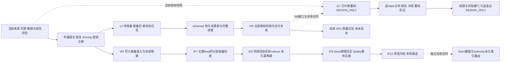

# AEMC 开发状态、架构取舍与发布进度

2026-10-28。IF0–IF8已合并：IF7的[PR #2](https://github.com/saigyujikingyo-png/companion-core/pull/2)合并为 `4e0892c`，IF8的[PR #4](https://github.com/saigyujikingyo-png/companion-core/pull/4)合并为 `ffa596eb403fd54f128b776d9d966c49dfa0da33`；各自独立验证、审查、精确head14/14与merge7/7 CI证据保留。[IF9 PR #5](https://github.com/saigyujikingyo-png/companion-core/pull/5)当前head `beed926203879bf31e3c4c6aefff124724accfc0` 已通过独立审查及14/14跨平台CI，仍OPEN / DRAFT、未合并；浮动Node验证严格能力拒绝，生产repack门未放宽。基于该head的IF10已实现不可变Safety终态单冷段，两位独立Astra max审查无剩余P1/P2；Sol一次独立本机1098/1098与strict TS通过，228执行文件前后无漂移。IF10目前LOCAL_VERIFIED / UNCOMMITTED，无IF10 CI。分层结果见[当前证据](AEMC-INFRA-EVIDENCE-IF10.md)，[IF9旧候选证据](AEMC-INFRA-EVIDENCE-IF9.md)保留历史时态。本轮未部署或启动训练；完整目标仍 **IN_PROGRESS / TRAINING_NOT_ADMITTED**，不计算混合完成率。

## 已落地的能力链

| 层 | 实际实现 | 仍不能推导的结论 |
|---|---|---|
| 来源与当前权限 | Store scope/consent/runtime、精确来源与完整祖先、撤销/过期复核 | 跨设备身份认证、真实素材使用权、事实语义为真 |
| IF0–IF2 存储与消费者 | M2隔离恢复、独立本机外锚、PREPARED/reconcile、旧anchored源fencing、KEK rewrap/DEK rekey、schema2双metadata消费者 | 生产custody、硬件防共同回滚、全局外部索引、十年容量 |
| IF3–IF4 热存储与导入 | 4096字节块replacement/XOR+Brotli4/raw、单blob、有界恢复链、保原密文备份、新目标compaction；M2冻结包导入、lineage防重和实际准入门 | 物理磁盘写次数、历史GC、旧M2副本fencing、真实私有库迁移 |
| IF5 / AR0b1 检索接线 | 完整durable projection在同一guard/冻结时间内与正文及祖先匹配；bind/refresh/query/resolve均复核消费者进度；过预算全拒绝 | 新排名算法、真实embedding/BM25/PPR、多跳或语言质量提升、宿主已接线 |
| IF6 容量失败处理 | 新PREPARED前预演最终化与日志预算；单pending全局新写门；捕获mutation异常也不能提交部分状态 | OS磁盘空间预分配、无限容量、全部旧异常pending可恢复、混跑旧writer安全 |
| IF7 容量观测 | 同authority guard读取exact head；不boot、不扫TTL、不改额度/epoch；分层计数与字节、受限目录扫描、冻结metadata输出；pending只给metadata | 当前检索许可、剩余可写次数、空间预留、历史GC/authority rollover、生产监控与真实容量接受 |
| IF8 回执容量治理 | 显式schema4；有界Brotli4完整回执分段、统一精确查回、同guard原子repack；永久PK/UNKNOWN/额度/撤销保持；同cap真实写失败后页复用并恢复业务 | 物理authority替换或缩文件、GC、无限容量、已超软界库修复、Store/Safety/永久索引长期增长、生产资格 |
| IF9 Store与Safety容量治理 | 显式repackStore仅私有RAM SQLite物理压实，完整逻辑指纹/新目标/fencing；新Safety profile有界raw/Brotli载体、展开前预算、完整原语义及自包含恢复 | 不清理长期索引、不突破8192/16MiB、不减少全部CPU/RAM路径、不保证所有载体更小；IF9提交CI已通过，PR仍草稿；生产未验收 |
| IF10 Safety终态冷段 | 显式P4升级与归档、热冷全局精确账本、新代际自包含重封、文件闭包、冷段备份/rekey/reconcile；UNKNOWN/幂等/反馈/额度和旧源fencing保持 | 仍限8192条、15帧/31数据文件及64MiB恢复预算；不GC、不突破长期容量；仅本机候选，无IF10提交CI，不保证总IO/RAM/CPU下降 |

IF5选择先接完整性边界：持久消费者已有实际进度，旧RetrievalService却仍依赖手工refs。新增 [durable retrieval](DURABLE-RETRIEVAL.md)使两者形成真实调用链，原AR0字面/共享来源排序保持不变；先解决选集的完整性与当前权限，再做排名质量实验。

IF6来自新审查发现的容量P2，而非原计划中的扩容工程。只将TEMP源码的64MiB读界缩到64KiB，就能通过真实API重现提交后越界以及PREPARED无法重开。修补保持64MiB读硬界，默认新增写准入为22369621B；预演同一最终化SQL，给数据库与回滚日志留界。一项未完成意图会阻挡同外锚的新写入；真正不写的读取与有预算的reconcile保持可用。boot及跨TTL查询需要持久写，仍可能拒绝。具体证明、旧版本兼容和失败记录见 [容量合同](AUTHORITY-CAPACITY.md)。

IF7先把容量瓶颈变成可核对的事实，再设计长期运维。新 [inspectCapacity](CAPACITY-INSPECTION.md) 即使面对合法但超写软界的authority、或已经因写失败而失效的live handle，也能通过静态入口观察ACTIVE源；PREPARED不读取stage或旧/新payload。报告区分实际验证过的恢复链、generation目录下界、16MiB镜像、Safety调用账本、fanout结构和authority receipts。compaction只降低新generation的历史链成本，不释放Store ingress、已消费额度或authority receipts。收缩这些账本必须另设保持幂等/UNKNOWN/撤销的协议。

IF8落实了上述协议的首个有界子集：[receipt segment rollover](RECEIPT-ROLLOVER.md)保留完整原始JSON与全部复合主键，压缩载荷并复用SQLite页面。普通UPDATE缩短回执未释放叶页的失败促成原子批量repack补充合同，原失败仍保留。普通131072B软界案例中61份回执的63847B原文存入7072B BLOB，32页文件保持、freelist 0→17；同cap fresh boot与新业务写入成功后余15页。它不清理消费记录，也不把freelist解释为磁盘缩小或剩余写次数。

IF9的普通Store案例schema1由172032缩至114688B、schema2由225280缩至167936B，完整值和撤销保持；8192条高熵Safety结构压力原JSON1917066B、carrier760496B，另有真实公开API历史/恢复验证。结构压力不是8192次真实持久历史；空Safety的carrier273B大于原143B。具体上下文见[成本分项](AEMC-INFRA-EVIDENCE-IF9.md)。

IF10将完整不可变终态从每次热Safety载体中分离，所有旧键仍经热冷联合校验。三组2/12/64请求、24次tail的观察均增加应用写入；另一个预先固定的256请求、64次tail案例由1138223降至881730B，但备份由47675增至180236B，保留磁盘也增加。详见[完整计量口径](AEMC-INFRA-EVIDENCE-IF10.md)；不据此宣称物理IO或通用性能收益，归档保持显式。

当前增量技术路线保持固定4KiB块replacement/XOR、标准Brotli4/raw、单密文blob和有界恢复链，定期向新目标compaction并保留旧加密源；IF9增加显式物理压实和packed Safety profile，IF10增加独立不可变终态冷段。它减少持久化逻辑写入放大；SQLite serialize仍产生整库RAM image，不能将磁盘文件增量收益表述为整条CPU/内存路径已增量化。生产外锚也仍须独立防共同回滚，文件放在另一个目录不等于硬件信任。

[新架构决议](ADR-MEMORY-TOOL-BOUNDARY.md)区分内在痕迹、外部工具原件与精确控制面：认知载荷可以有损、重新解释并可逆冷热迁移；原文件搜索/读取是工具动作；IF8–IF10幂等、UNKNOWN、撤销与额度仍精确。这不修改当前Store内容语义或宣称MemoryTrace/AffectTrace已实现。后台inspect/预取与实际回忆唤起分开，重复回忆不是新的独立事实证据。

## 总目标进度

[完整矩阵](AEMC-INFRASTRUCTURE.md)的18项按当前缺口互斥分类如下。IF5补I05接线，IF6补I01/I02故障处理，IF7补容量观测，IF8补回执压缩/页复用，IF9补Store碎片/Safety载体，IF10补终态冷段与恢复闭包；三域与I17设计不改变分类。没有把质量、生产或完整训练前项自动转为已接受。

| 当前类别 | 数量 | 条目 |
|---|---:|---|
| 本机实现子集，完整目标开放 | 4 | I01存储、I02密钥/恢复、I03存储协议/成本、I05多消费者 |
| 已有局部基础，独立接受开放 | 4 | I00权威、I09背景/关系、I14语言/宿主、I16历史/cache |
| DESIGN_ONLY | 6 | I04概念、I07多模态、I10sleep候选、I12跨代、I13后端、I17元记忆 |
| NOT_STARTED | 3 | I06质量实验、I11自主sleep、I15具身 |
| UNDECIDED | 1 | I08候选机制取舍 |

完整训练前接受仍为0项；这不否定已通过的本机子集，也不将局部通过外推到整项目。物理终端覆盖D01与生产信任域D02等决策继续开放。

## 验证层与后续顺序

[IF4证据](AEMC-INFRA-EVIDENCE-IF4.md)保留原822/822、类型检查和三组成本测量；相对同codec完整快照，hot逻辑新增字节减少47.38%–49.58%，不是设备物理写入量。IF5作者关联159/159与独立静态审查完成。IF6作者分项含真实进程恢复、hot journal、legacy登记回滚、吞异常和TTL跨vault接缝，失败/环境拒绝与返验分别保留。[最终IF5/IF6组合证据](AEMC-INFRA-EVIDENCE-IF6.md)已闭合：独立874/874、typecheck与成本测量通过，134源码文件逐项一致，两位独立终审无剩余可操作P1/P2。相对完整br4，三种工作负载的hot逻辑新增字节分别减少47.40%/49.08%/49.64%；不把各轮专项数量相加。

原 `06fc8b2` 冻结的 [IF7证据](AEMC-INFRA-EVIDENCE-IF7.md)保留作者19/19专项、161/161关联、TS0及两位独立Astra max审查。Sol当时一次独立893/893与TS0、136文件前后及作者manifest一致。新的WF2整合组合另做一次984/984与TS0，162代码文件前后无漂移；各轮不相加，精确提交CI单独记账。两轮均未重测旧压缩成本。

下一步按依赖推进：

1. IF0–IF8发布闭环完成。IF9的PR #5已有精确head14/14 CI与独立审查，仍草稿、未合并；不得把浮动runtime的明确拒绝解释为该版本VACUUM已接受。IF10两路独立审查及本机1098/1098与TS闭合，当前未提交，无IF10 CI；下一发布层另行绑定精确候选。
2. 容量运维：[Safety不可变终态单冷段](SAFETY-COLD-SEGMENT.md)的本机子集已实现。后续分别冻结Store ingress/图闭包和authority永久PK/legacy路由合同，包含跨段查询完整性、撤销/消费者引用、可信根切换、失败恢复和总成本；尚未实现。IF10仍保持8192总限，不丢旧ID/UNKNOWN，不因inspect空blockers自动写入。
3. 生产信任域：冻结authority/custody owner、独立备份/共同回滚威胁、实际恢复RPO/RTO与旧writer停用方案，再做真实环境准入；目录名字本身不提供信任。
4. AR1质量：先固定来源权利、query/support答案、家族/时间切分、算法版本、质量与总成本门，再比较BM25、embedding、PPR及seed策略。检索引用有效不等于答案正确；本轮不调用模型或训练。
5. [I17](BAYESIAN-RECONSTRUCTION-DESIGN.md)与[痕迹/PDF双路径/情感唤起最小切片](ADR-MEMORY-TOOL-BOUNDARY.md)先冻结有限输入、先验/似然、修订及预算；稳定基线上独立实现，不等待所有容量或I06算法完成。正式family/time split、校准/查证和耦合收益独立接受；目前DESIGN_ONLY / EXPERIMENT_NOT_RUN。概念registry、可撤销状态、sleep和跨代迁移各自开放。

## 发布与隔离边界

此前 IF0–IF6 发布为 `codex/aemc-infrastructure-20261027` 的基础设施候选，目标为**公开**GitHub仓库 `saigyujikingyo-png/companion-core` 的 `main`。用户确认后，Sol完成四个提交、PR和条件核验；50文件中的后续修补只涉及合成测试可移植性、测试单worker调度与子进程失败诊断，生产src保持首提交内容。精确最终head `4871f165f8a42fe8eb243d713e88819225d77e71` 两组四平台CI均通过，当时main仍为原基线 `d23921f5abc5be10f15883a1a5289af842299b3f`，无冲突/新阻断，随后普通合并。合并树与已验证head树相同，合并后main四平台再次通过。

已保留IF4历史38文件原生TEMP候选，含按旧132源码manifest验证的恢复文件；早期沙箱TEMP副本未跨调用保留，已明确作废。最终IF5/IF6候选另存完整文件清单、字节快照与hash，精确原生TEMP位置记在排除入库的交接中；不能冒称等于旧候选。公开文档使用 `%LOCALAPPDATA%\Temp` / `<INFRA_WORKTREE>` 路径占位符，原始日志及本地交接保留精确路径。

IF7原工作树保留冻结候选及恢复提交，源码作者为Astra xhigh；原冻结时未提交、未发布且无新CI。Sol随后从WF2 main `87eab00` 新建独立整合树，只机械保留README/ROADMAP双方段落并校正文档时态；5个IF7源码/测试文件与原冻结逐字节一致，其余main代码不改。新组合162代码文件验证与精确PR/CI分层留证，PR #2最终已合并；[发布回执](AEMC-INFRA-EVIDENCE-IF8.md)记录14+7 CI及精确hash。IF8另开树并将全部219执行文件冻结，源码作者、只读审查和Root文档单写者分工。原Core/WF2、storage lab及旧infra树保留各自成果，机械发布与验证按用户要求由实际GPT-6.1 Sol承担。

合并不构成部署、真实私有迁移、provider调用或训练准入；这些接受层始终单独记录。
