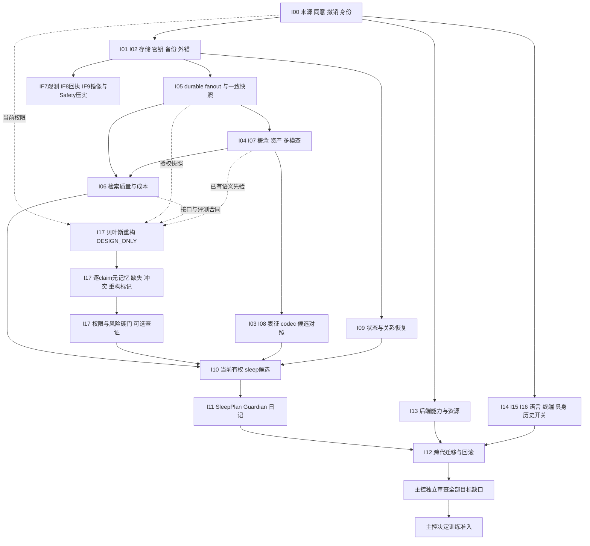

# AEMC 训练前基础设施总矩阵 / IF9

[当前开发状态](AEMC-DEVELOPMENT-STATUS.md)汇总18项目标。IF0–IF8已合并；IF8经独立1004/1004与TS、独立审查和head14/14 CI后由[PR #4](https://github.com/saigyujikingyo-png/companion-core/pull/4)合并为 `ffa596e`，合并后7/7 CI通过。[IF9](CAPACITY-REPACK.md)在独立树实现Store镜像物理压实与显式Safety载体，作者24/24、关联204/204与TS0、两路独立源码审查通过，独立1028/1028与TS通过、221执行文件0漂移；LOCAL_VERIFIED / UNCOMMITTED，无IF9 CI。详见[当前证据](AEMC-INFRA-EVIDENCE-IF9.md)。IF9推进I01/I03；[三域决议](ADR-MEMORY-TOOL-BOUNDARY.md)与[长期容量设计](LONG-TERM-CAPACITY-DESIGN.md)不关闭其余目标。I06质量实验未启动，本轮未部署或训练。

日期：2026-10-27。总状态：**IN_PROGRESS / TRAINING_NOT_ADMITTED**。本文件是完整范围的实施台账。[IF0](AEMC-INFRA-EVIDENCE-IF0.md)、[IF1](AEMC-INFRA-EVIDENCE-IF1.md)、[IF2](AEMC-INFRA-EVIDENCE-IF2.md)保留原快照证据；新 [增量存储/压实](INCREMENTAL-STORAGE.md)与[旧M2导入](LEGACY-M2-IMPORT.md)落实当前本机子集。任何切片都不替代全部目标。

## 来源与证据

- [当前IF9与IF8发布证据](AEMC-INFRA-EVIDENCE-IF9.md)：PR #4在精确head14/14 CI及独立审查后合并，merge7/7 CI通过；IF9基于该merge冻结221执行文件。历史[IF8候选](AEMC-INFRA-EVIDENCE-IF8.md)219文件/1004项与[IF7候选](AEMC-INFRA-EVIDENCE-IF7.md)原136文件/893项、WF2整合162文件/984项分别保留，不相加或倒写历史时态。
- [IF5/IF6 历史组合证据](AEMC-INFRA-EVIDENCE-IF6.md)：874/874、typecheck、两位独立终审与固定协议成本测量通过；相对完整br4的hot逻辑新增字节分别减少47.40%/49.08%/49.64%。原134源码文件冻结及当时尚未执行CI的状态保留；不把旧成本测量当IF7的新测量。
- [IF3/IF4 历史组合证据](AEMC-INFRA-EVIDENCE-IF4.md)：822/822 whole、typecheck、两位独立终审和最终三 arm 成本测量通过。相对同 codec 完整快照，各工作负载减少47.38%/49.14%/49.58% hot逻辑文件增量；保留源文件，未做GC。该本机合成接受不关闭矩阵其余缺口。
- 开工基线：`d23921f5abc5be10f15883a1a5289af842299b3f`。manual worktree 分支：`codex/aemc-infrastructure-20261027`；已核 top-level、clean 初态及 log-5。它不是 app-managed worktree。
- 独立只读查询 GitHub 确认 [validation 40425316221](https://github.com/saigyujikingyo-png/companion-core/actions/runs/40425316221) 与 [main 40425590234](https://github.com/saigyujikingyo-png/companion-core/actions/runs/40425590234) 均为上述 SHA，Windows/macOS/Ubuntu24.x/Ubuntu24.16 四个 job 均 SUCCESS。这些历史结果只覆盖当时基线，不覆盖IF7或当前WF2整合组合。
- 用户研究材料《AEMC v0.9 自主睡眠与跨代认知连续性整合研究总纲》SHA256：`0aef56521b4c809f25dd0ea9051803889ec278a842f1841d143c7e1f81425ec5`。只读材料，不复制原件或把其中设想当执行许可；其 v0.6 附录与新主张分账。
- 本目录基线文档的已实施/研究阴性/历史原生回执均保留；没有读取真实聊天、私有记忆、密封教学或旧运行库。WF1 DS1/GPT0 STOPPED、0产物是主控交接状态，本批不重试、不重放、不修改 campaign。
- 证据层固定为：静态合同 → 作者专项 → 独立审查 → whole → 精确新提交 CI → 原生宿主 → 产品/科学接受。各层不相加、不互替。未获得的层标 NOT_RUN/NOT_STARTED/UNKNOWN。
- 矩阵中的采用是架构选择；没有独立质量与权利验收时，不等于训练前项被接受。延期/替换/不采用候选也必须提交目标等价证据与剩余缺口。

## 全范围矩阵

| ID / 训练前目标 | 冻结基线中已有的实现或证据 | 当前缺口与实施状态 | 版本化合同 / 验收出口 |
|---|---|---|---|
| I00 来源、身份、当前同意与撤销权威 | Store scope/generation/consent/runtime、来源 DAG、撤销级联；SP0A 当前来源复核；WF0 仅声明 lint | 跨设备认证、真实使用权证明、全局家族 registry 未完成；已有局部实现 | AuthorityContext/0.1、SourceUseDecision/0.1；跨租户/ABA/时钟/过期/缺祖先拒绝；角色不替代权限 |
| I01 十年存储与可恢复运维 | exact外锚/PREPARED；[v3](INCREMENTAL-STORAGE.md)块差分/有界链；[IF6](AUTHORITY-CAPACITY.md)容量门；[IF7](CAPACITY-INSPECTION.md)分层观测；[IF8](RECEIPT-ROLLOVER.md)回执rollover；[IF9](CAPACITY-REPACK.md)Store物理压实/Safety packed载体 | **本机有界子集已实现**；16MiB image/256MiB代际/4096 commits/Safety8192、authority64MiB读界/22369621B默认新写界/128段仍在；serialize仍整库，永久索引/冷段路由/GC/物理authority切换/十年资格未完成 | 保留迁移前旧加密源、receipt/幂等键、UNKNOWN及撤销；内在痕迹有损不适用控制面；检查非写许可，旧无预算pending仍unresolved；完整成本/RPO/RTO另测 |
| I02 密钥托管、迁移与回滚 | 独立DEK/稳定ingress、recipient rewrap、current-state rekey、anchored源fencing；[旧M2导入](LEGACY-M2-IMPORT.md)含schema3来源唯一槽与实际准入门 | **本机协议已实现**；production/远程/硬件custody与真实跨机托管未完成；authority须独立防回滚，旧M2副本不受fence | 旧native ID/额度/反馈/撤销保持；新DEK不同，legacyKey保留作HMAC；receipt明确非latest/非legacy fencing，不称历史crypto-erasure |
| I03 独有文件格式与压缩的总收益 | Scene JSON、TJ0/Q0阴性保留；v3块增量+Brotli4与同codec full/v2 raw对照；IF7分层占用、IF8回执段/page复用、IF9镜像碎片压实和Safety完整载体计量 | **存储协议子集已采用**；内在痕迹按类型/任务失真编码见[三域决议](ADR-MEMORY-TOOL-BOUNDARY.md)，尚未实现；不是新通用codec或认知质量成果，长期成本仍开放 | CodecProfile/0.1、CostQualityTrial/0.1；完整carrier/索引/字典/decoder/backup计费；空Safety可能变大，结构压力与合法API历史分列；freelist非磁盘回收 |
| I04 稳定概念地址与跨模型映射 | Scene 固定catalog、精确概念/profile引用与opaque residual声明 | **DESIGN_ONLY**：概念registry冲突/版本/别名/撤销、模型特征对齐、重嵌入与不可映射项；当前不能换模型直接复用latent | ConceptRevision/0.1、FeatureBinding/0.1；模型/encoder/layer/basis/adapter/calibration全pin；冲突、漂移、弃用、失配拒绝 |
| I05 durable多消费者 | [schema2](DURABLE-FANOUT.md)编号迁移、双metadata投影/checkpoint、TTL/retention与v3持久化；[IF5](DURABLE-RETRIEVAL.md)完整consumer选集已接bind/refresh/query/resolve | **有界持久metadata及本地检索接线已实现**；无历史逐revision日志、外部索引持久协议、向量/完整scene引擎或生产宿主接线；RAM重建成本仍在 | 单guard当前metadata/body/祖先一致读，consumer完整进度与能力失效，超AR0预算全拒绝；TTL写被capacity/pending拒绝时无stale结果；C04完整目标仍开放 |
| I06 BM25/向量/PPR及多跳质量 | AR0有界当前memory召回/同版RAM投影；不是AR1实验 | **NOT_STARTED**：冻结query/家族/时间切分、真实embedding、BM25、PPR、mean与sampled seeds质量/总成本对照 | RetrievalEvaluation/0.1；Recall@k/nDCG/证据覆盖/虚假边/置信校准、p50/p95/RAM；删除一致性独立硬门 |
| I07 选择性多模态对象/关系/声音残差 | SP0/SF0对象、claim、坐标/profile/资产声明与JSON交换；SP0A来源绑定 | **DESIGN_ONLY**：原文件归工具域；MemoryTrace/ToolRecordRef、实际感知、特化有损codec、decoder迁移、声音锚点和冷热放置未实现 | AssetManifest/0.1、SceneEvolution/0.1及[三域草案](ADR-MEMORY-TOOL-BOUNDARY.md)；缺失/损坏/撤销拒绝，原件访问须工具；感知/任务/重建/韵律分测 |
| I08 Hopfield/SDM/HDC/SAE/小扩散取舍 | 文档候选；Q0仅有限given-address表征，不证明自然检索 | 各候选 **UNDECIDED**；不默认全装，不以不采用免除模式补全/检索/可解释性目标 | CandidateTrial/0.1；每个候选对工程基线、容量/串扰/质量/训练依赖/总空间/p95/功耗；见研究ADR |
| I09 情绪背景与关系持续、果蝇对照 | 多尺度背景/反馈/来源撤销；有限在线神经worker；已有真实图阴性对照 | 跨重启状态目前reset；非语言AffectTrace、实际唤起与情感场双向耦合、可解释恢复/消融未完成；后端待定，主观体验非软件验收 | PersistentState/0.1及[AffectTrace草案](ADR-MEMORY-TOOL-BOUNDARY.md)；维护不触发唤起，无/单向/双向同预算与反馈稳定性分测 |
| I10 sleep清洗与候选权限 | L1.a RAM lint同源分组/时间切分/当前许可；WF0声明；J0/TJ0/TJ1分层日记 | **DESIGN_ONLY**：新经历触发解释修订/再编码、持久跨批去重、语义冲突、rehearsal/重授权；不启动训练 | SleepCandidate/0.1、FamilyRegistry/0.2、ConflictRecord/0.1、ReplayPurpose/0.1及MemoryRevision草案；事件时间/解释时间分开，不保留全部旧高维载荷也不能丢控制墓碑 |
| I11 自主睡眠、任务承诺与成长日记 | 日记和有限后台调度已有部分基础；尚无自主睡眠生命周期 | **NOT_STARTED**：SleepPlan/Guardian、最长离线、任务交接、授权唤醒、取消checkpoint、晨间恢复、告知权限 | SleepPlan/0.1；固定/随机闲时/启发式选择对照，服务冲突率/学习价值/小时/中断；无权重更新也可sleep，不自动群发 |
| I12 跨代身份、能力迁移与激活回滚 | 四域分层设计；J0声明与TJ1独立小canary不能代表Student迁移 | **DESIGN_ONLY**：旧新模型shadow、概念/索引重建、人格/中文/工具回归与受信激活；冷热放置和参数巩固是不同维度 | GenerationMigration/0.1；保留agent_id，KV/激活不移植；重建不升级为verified，旧模型错误不洗成教学真值；Root决定训练/激活 |
| I13 跨CPU/GPU/NPU及Spark/MI250X | 证据选择器和有限CPU/CUDA研究；其他真实设备状态按交接/源码为未知或未测 | **DESIGN_ONLY**：每设备/模式/算子/精度/框架精确profile；双Spark和MI250X实机与资源未准入 | BackendProfile/0.1、ProbeReceipt/0.1；inference/update/backward分开；每GCD/分布式拓扑、峰值内存/传输/p95/故障 |
| I14 多语言、全终端、社交/商业接口 | zh/en/ja/mixed/unknown标签；M1受信绑定、幂等、限流、取消；部分DSH/Codex原生历史证据 | 远程认证、语言质量、移动/穿戴/Windows/Linux/macOS/其他Agent与社交平台逐端覆盖未完成 | LanguageEnvelope/0.1、HostSession/0.2、DeliveryEffect/0.1、ProviderUsage/0.1；重复/断连/取消/未知/晚到/配额；协议与实机分列 |
| I15 具身接口及物理终端范围 | ActionProvider/MediaAdapter窄接口与设计 | **NOT_STARTED**：模拟控制器/实时场景/单位/坐标/看门狗/制动回执；全部物理端是否必须部署 **UNDECIDED_ROOT_DECISION** | EmbodiedAction/0.1、TerminalCoverageDecision/0.1；模拟后独立实机准入；停止请求不当物理已停止 |
| I16 无历史检索与cache控制 | 主控已有开/关/撤销+cache专项授权；本批未重新读取生产配置 | 当前本地状态清理/拒旧能力、provider history/KV范围需独立验收；云端KV清除 **UNKNOWN** | HistoryAccessPolicy/0.1；off后新请求无历史引用、撤销fence、cache作用域/代际/过期；不得声称远端已遗忘 |
| I17 贝叶斯重构、元记忆与按风险查证 | 原稿§8及[侧边提案整合](BAYESIAN-RECONSTRUCTION-DESIGN.md)：当前有权先验/检索痕迹→有限候选后验→逐claim缺失/冲突/重构状态→可选查证；当前来源引用检查不等于真值验证 | **DESIGN_ONLY / EXPERIMENT_NOT_RUN**：A数学合同与预注册；B在IF8闭环后实现有界模块；C冻结家族/时间切分实验。依赖I06接口/评测合同，不依赖全部排名算法；主控定义硬门 | MetamemoryAssessment/0.1、VerificationDecision/0.1；先验/似然依赖、零证据/候选miss/权限拒绝、校准/覆盖/查证收益与成本分列；高风险硬核验不可被VOI估计覆盖 |

## 依赖图

研究可并行，数据和执行门不能跳过。I17的虚线是数据/合同依赖，有限离散原型不等待I04/I07全部工程或所有I06算法；先验和痕迹都须当前有权，查证或训练不能由图自动触发。I03/I08任何未决/不采用须给等价目标证据；I15终端未决仍是开放前置。

[三域架构图](ADR-MEMORY-TOOL-BOUNDARY.md)补充内容语义：I04概念/profile约束特化痕迹，I06分别评价回忆与工具查档，I17先验/痕迹须有来源与不确定性。热度、事实置信、情感强度、可核验性分账；新证据可修订解释，重复回忆不产生独立证据。当前分类仍4/4/6/3/1，完整训练前接受0项；新设计不等于代码或效果已接受。

## 所有权与工作方式

| 责任 | owner与实际边界 |
|---|---|
| WF1数据链路、科学/产品整合、最终接受、训练启动 | 主控原聊天；本聊天不能代为启动或把stage当接受 |
| 本工作树架构、合同、持续实现与交接 | 本基础设施聊天；目标Astra ultra，实际模型/effort由创建方工具回执核验，本文件不以自称代替证明 |
| 深研究和关键只读审查 | 工具实际指定 `gpt-6-astra / max` 的存储与表征研究代理 |
| 高难M2实现 | 工具实际指定 `gpt-6-astra / xhigh`；唯一临时写者，交回后由基础设施Root整合 |
| 常规资料/测试/部署协调 | 工具实际指定 `gpt-6.1-sol / high`；只读核查或单写者交接后执行 |
| 导师/教师 | Astra+Claude Fable精确ID/effort待核；导师仅架构运营metadata。具具体用途许可的独立教师负责教学；不冒称Opus、不把角色当许可 |
| 合并/部署/物理动作 | 合并须用户确认；新实际调用/训练/租赁/采购不由本交接新增额度。真实有界验收可以准备具体准入 |

不得并行写同目录；审查代理只读。新修改不覆盖主控Core、旧MVP后端/venv/DPAPI/DSH或历史ledger。本批无原生宿主操作；DSH依然只允许官方CLI/MCP/公开SDK。

## 开发与接受顺序

| 阶段 | 可审查交付 | 不得略去的接受条件 |
|---|---|---|
| S0 本轮 | 全矩阵、ADR、版本合同；M2 head pin/密文backup/隔离恢复代码 | 专项+类型检查+独立只读审查+whole；新提交CI另列。所有开放前置仍开放 |
| S1 存储治理 | 外锚持久化、恢复/源实例fencing、key custody与迁移演练、冷热层与容量/备份运维 | 原件保留，新目标恢复；撤销/额度不倒退；新机钥匙恢复与灾难演练；无外锚不签抗回滚 |
| S2 持久投影 | schema2离线迁移工具、metadata invalidation journal、各消费者ACK/重建和删除屏障 | schema1黄金库不改；原子批次、崩溃重投、慢消费者、旧ACK、TTL/pause、基线watermark；独立审查 |
| S3 检索/资产/状态 | BM25/embedding/PPR候选端口、稳定地址registry、资产引用、可撤销状态持续、逐事实元记忆与风险查证 | 冻结质量/成本/许可协议后再跑研究；来源引用有效不当语义正确；应查未查与无谓查证分测，性能/功耗分别测 |
| S4 sleep/跨代/后端 | 可解释睡眠决策、候选生命周期、版本化日记、shadow迁移、逐设备probe | 无授权执行路径不接trainer；取消资源释放、权限fresh、外部效果UNKNOWN不重放 |
| S5 全端接受 | 多语言与宿主兼容矩阵、社交/商业权限、具身模拟/实机、历史检索开关 | 主控先裁定完整终端覆盖要求；每端原生回执与真实有界准入；不凭模拟宣布部署完成 |
| S6 独立训练前评审 | 每ID证据、替代方案等价性与剩余缺口、成本/风险、许可/预算/数据manifest | 只有主控可给具体训练准入；未决项不能自动变PASS |

运行前检查当前CPU/RAM/设备与共享预算，开发测试使用独立TEMP合成数据、低并发；运行产物不进入源码/OneDrive。必要研究小训练按具体目的/资源另核现有未消费授权，既非永久禁止，也不借“实验”绕过Student门。

## 必须保持开放的决策

- D01：全部物理终端必须先部署，还是协议边界阶段先完成。**UNDECIDED_ROOT_DECISION**；记录完整清单和每层证据，不能自行减项。
- D02：本机参考后端已选择独立配置SQLite authority；生产托管位置/owner、如何防与vault共同回滚仍开放，目录或domain名字本身不提供硬件信任。
- D03：本机恢复/迁移已通过owner epoch和whole-operation guard撤销旧writer；远程跨设备部署、RPO/RTO、备份频率/第三副本及灾难演练仍开放。
- D04：独立KEK/DEK/稳定幂等键、两类迁移与旧M2包导入协议已实现；跨机custody服务、真实recipient/私有M2迁移和历史key保留运维仍开放。
- D05：AR1/多模态/情绪/迁移的冻结数据、质量门、成本预算与真实输入许可；不先看结果再设门。
- D06：语言与终端覆盖的具体产品清单、商业用途、实际动作级权限；“全语言/全端”不能仅用三个标签验收。

这些待决策不阻塞独立代码、合同和合成验证；到依赖它们的实际准入时提交具体可审查结果。

相关入口：[ADR与研究证据](AEMC-INFRA-RESEARCH.md)、[合同0.1](AEMC-INFRA-CONTRACTS.md)、[首片M2](M2-BACKUP.md)。
