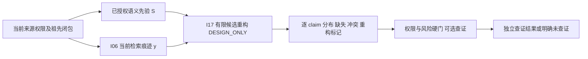

# I17 贝叶斯重构、逐 claim 元记忆与可选查证

2026-10-27。**DESIGN_ONLY / EXPERIMENT_NOT_RUN**。本提案并入 I17，不新增一个被宣称完成的基础设施目标。它来自侧边研究提案及独立复核；当前没有实现推断模块、连接 Store、修改持久 schema、调用模型或启动训练。[当前架构](AEMC-INFRASTRUCTURE.md)与[开发状态](AEMC-DEVELOPMENT-STATUS.md)继续按 18 项记账。

[新三域决议](ADR-MEMORY-TOOL-BOUNDARY.md)补充输入语义：长期内在痕迹允许有损和被新经历重新解释，PDF等原件属于主动工具路径；IF8/IF9精确控制账本不受有损规则影响。S先验、y痕迹及情感情境分别保留profile/来源/当前权利和不确定性，重新解释不自我升级为verified。纯inspect/预取不触发情感唤起，重复回忆不作为新的独立证据；核对原句需真实工具动作，权限拒绝与缺失分开。有限原型可与痕迹/PDF双路径切片并行设计，不等待长期容量全部解决；目前仍未实现或实验。

## 采用的路线与文献边界

在当前有权的来源快照及完整祖先闭包之上，增加“有限候选贝叶斯重构 → 逐 claim 元记忆 → 可选查证”。I06 提供检索接口与冻结评测合同；研究原型不必等全部 BM25、向量、PPR 排名算法完成。检索和推断不能绕过既有权限、撤销或能力失效边界。

Hemmer 与 Steyvers 的 [A Bayesian Account of Reconstructive Memory](https://sites.socsci.uci.edu/~phemmer/Hemmer_Steyvers_topiCS.pdf)研究物体大小记忆，讨论类别和对象先验与噪声记忆的结合。这里借用其问题形式，**将它扩展到 AEMC 是待验证的工程假设**；论文没有验证本项目的事实正确率、置信校准、查证收益或图权重衰减律。原总纲仅作为研究输入，保留原件 SHA256 `0aef56521b4c809f25dd0ea9051803889ec278a842f1841d143c7e1f81425ec5`，不从研究设想推导执行许可。

## 最小数学与状态合同

查询条件 q、候选域 C、先验版本、观测模型版本及当前来源引用必须显式给出，并纳入快照及评测标识。首个原型限定有限离散空间：`p(x|y,S,q) ∝ p(y|x,S,q) p(x|S,q)`，保留完整归一化分布与推断所用条件。若先验与检索痕迹同源，必须明确依赖模型或去重，不能当独立证据乘两次。图相似度、检索排名和 LLM 自报置信度不能直接当似然；零先验不能被有限似然“纠正”。

| 情形 | 要求的输出边界 |
| --- | --- |
| 确实没有痕迹 | 只有预先声明的无信息观测模型才能返回 `PRIOR_ONLY`；仍标记缺失和重构。 |
| 权限拒绝、撤销或过期 | 返回对应拒绝，不能转成缺失后用先验猜出被禁止的私人事实；S 与 y 都复核当前权利。 |
| 所有候选权重为零 | 明确 `ZERO_EVIDENCE / MODEL_INCOMPATIBLE`，不静默退回均匀或先验；数值下溢另报。 |
| 候选覆盖未知或发现漏项 | 运行时通常没有真值，允许 `COVERAGE_UNKNOWN`；只有独立证据或评测真值确认后才记 `CANDIDATE_MISS`，不能把 oracle 信息输入推断。只有显式定义先验及似然时才加入 OTHER；否则后验仅条件于 C。 |
| 低熵但来源冲突 | 冲突标记仍保留；分布集中不能把重构升级为已验证事实。 |
| 查证未执行或失败 | 保留 `NOT_VERIFIED` / 失败原因；预测收益不是实际查证收益，重构输出不能成为自身的新独立证据。 |

元记忆至少分开记录分布、候选覆盖、来源状态、缺失、矛盾、推断/直接观察及实际查证结果。获取一个数值后验不自动形成校准、真实性认证或训练标签。

查证策略先固定行动集、损失、成本及工具观测模型（含失败），再计算期望价值；缺少这些条件时输出 `VOI_UNAVAILABLE`。权限、高风险和不可逆行动的确定性硬门独立生效，不能被估计 VOI 覆盖。查证不默认发送消息、访问私有资料或消费模型额度。

## 分阶段交付与接受

| 阶段 | 产物与依赖 | 当前状态 |
| --- | --- | --- |
| A 数学合同与预注册 | 冻结候选域、输入权利、先验/似然、缺失/冲突/零证据规则和评测定义；可与 IF8 容量工作并行研究。 | 设计路线已纳入；正式可执行合同待实现前冻结。 |
| B 有界模块 | IF8 实现、测试与独立审查闭环后，在独立工作树实现纯函数有限离散模块及确定性黄金/对抗用例；输入仅固定已授权快照，不连接训练链。 | NOT_IMPLEMENTED |
| C 质量与成本实验 | 固定 family/time split，先锁先验/似然/阈值/ECE 定义和 bins，再碰 holdout；比较 prior-only、trace-only、Bayes，oracle 额外信息单列。 | EXPERIMENT_NOT_RUN |

阶段 C 的候选域与可用信息须可比，先验和痕迹两端均防同源/时间泄漏。明确报告 Brier、ECE、selective risk–coverage、错误补全率、应查未查率，以及实际查证收益和总成本。Brier/ECE 仅在存在有效概率输出、预测与标签域可对齐的样本上计算，同时公开有效覆盖数和分母；不能给失败/未知项填造概率。漏项、失败和拒答仍留在覆盖/失败统计，权限拒绝另列，各指标分母预先定义。不能根据 holdout 结果再调阈值而仍称冻结评测。没有实验就不声称重构改善记忆、元记忆已校准或查证更省成本。

本研究不会改变 IF8 保留原始回执和永久幂等键的合同。重构是带来源与不确定性的新候选结果，不是对账本、UNKNOWN、撤销记录或原件的有损替换。
