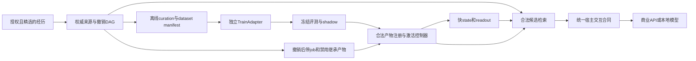

# 选择性经历、联想记忆与长期学习

状态：**L1.a 的同步 RAM 声明 lint / 候选 manifest 已实现，其余学习路线 DESIGN_ONLY**。L1.a 切片仅用合成数据验证结构、来源与隔离机制，未在该切片训练或进行语义自动清洗、翻译质量验证、多模态采集、模型激活；独立 TJ1 小 canary 的实际数值训练另行验收。`CURATION_LINT_PASS` 只表示检查完成，可包含全被隔离或空的候选；training/eval quality 始终 `NOT_EVALUATED`。

[J0 GrowthJournal](GROWTH-JOURNAL.md)补充了受信本地 curation 包装器的有界 RAM 操作日记与安全声明导出：真实 lint/revalidate 与固定模拟训练/产物/评估/激活分别记录，失败或回滚不抹掉已有事实。它没有 trainer、外部runner认证或受信历史恢复，实际训练/模型调用仍为0；JSON与LLM叙述不能自报完成。

“成长日记”的目标是记录真实微调/持续学习训练履历，并以源码/OneDrive 外私有硬盘冷存储为权威、RAM 仅缓存；版本化逻辑格式与 container/codec 解耦，支持后续专属无损压缩/解压研究。独立 [TJ0 磁盘协议](TJ0-DISK-FORMAT.md)已实现有界合成声明、跨进程回读/索引重建，始终 NOT_AUTHENTICATED；独立 [TJ1 Windows canary](TJ1-CANARY.md)已完成一次真实 CPU 小 readout 64 步/导出/新进程 reload/独立 eval；通用训练、预训练/LLM 微调及激活仍未实现，跨重开仅声明/需 reconcile。现有 J0 不具备真实训练履历或可信跨重启恢复，不能把 curation/模拟回执升级为真实训练。

后续 Student v1 与学习资产遵循[目标决策](TARGET-DECISIONS.md)：优先自然中文、共情情境、角色关系一致、主动交流合宜和长期状态连续，以独立盲评/保留集及消融验收；科学推理、工具、事实来源和执行真实性各守硬回归，不由平均分掩盖。通用公开底座与私有实例记忆/个性层分离；此为 **DESIGN_ONLY**，不宣称人类级或新训练完成。

## L1.a 已实现的窄接口

`MemoryStore.curationSnapshot(epoch, publishedRefs)` 在一个只读事务中先核当前 scope/consent/learningAllowed，再捕获一个非负安全整数 `asOf`。只收当前可见、有效的已发布 memory；原始 event、pending、跨 scope、未来生效、过期、撤销或版本冲突整次拒绝。旧 node 的历史 consent revision 不代替当前 scope 权限，也不会误阻止新授权读取仍合法的旧来源。

专用有界 DAG 查询不先调用旧的无界 ancestry helper。上限为 selected refs **32**、closure nodes **128**、真实 edges **512**、累计 UTF-8 预算 **262144**。SQL 先取正文长度并验预算，再取正文；父边查询最多取剩余边额度加一，入队前验节点上限。`counts.bytes` 是**保守累计预算成本**：读取的 node metadata、raw body、边，加上整个返回结构（含重复的 selected→root 映射），不是单纯 manifest JSON 长度。超限、缺父、cycle、无 event 根均 fail closed，无部分结果；合法 diamond 去重节点但照计真实边。0 refs 仍验 authority/健康状态/asOf；空 scope purge 仍使旧能力失效。此入口、lint、revalidate 均不写 DB 或调用 persist。

`CurationService(store, trustedPolicy)` 只供受信本地代码；没有新 host、stdio、网络或真实数据接入点：

- `bind({epoch, publishedRefs})` 返回本 service 的 opaque handle；不会创建 scope 或改变许可。
- `lint(binding, rawJson)` 返回 opaque candidate、深冻结的私有 RAM manifest 和无正文/内容 hash 的 report。
- `revalidate(binding, candidate)` 先重新取得当前权威 snapshot、校全部来源与 TTL，再核原 binding、policy、canonical payload 和规则，即使 admitted=0 也不跳过。
- `unbind(binding)` 废止能力；复制/JSON 序列化的 handle、其他 service 或其他 binding 的 candidate 均不可用。policy、epoch、refs 和输出均复制后深冻结，不冻结调用方原对象。

可信 policy 固定 `version=1`、`curationVersion`、`annotationVersion`、`selectionVersion`、`cutoff`。输入 JSON 闭合为 `{version:1, rows:[...]}`，解析前最多 **65536 UTF-8 bytes**，最多 **128 rows**。每行字段：`memoryIndex`、`rootIndex`（只选择 binding 已核的条目/根）、`variant`（original/translation/summary）、`language`（zh/en/ja/mixed/unknown）、`split`（train/eval/quarantine）以及 `annotation`。只有派生 variant 可携带 `derivedText`（最多4096字符）；original 的正文只能取权威 `Evidence.selectedText` 原字串，`MemoryRecord.statement` 明确是派生表达。完整 manifest 的体量由这些行数/文本/raw/snapshot 界限共同约束，不把 snapshot 的累计预算误称整个 manifest 字节数。

annotation 闭合字段为 `origin`（human/synthetic，声明标签而非认证）、`claimKey`、`polarity`（affirmed/negated/unspecified）、`condition`、`quotation`（direct/quotation/unknown）、`quotationSubject`、`uncertain`。字符串标签最多128字符；condition 空串表示明确声明无条件，null 表示未知并隔离。direct 必须 `quotationSubject=null`；未知或未归属引语保持待定。语言/否定/引语/条件标签由人或后续流程提供，当前不从任意文本自动识别，更不验证其正确性。

`sourceActor` 只能取被选 event 的 `Evidence.speakerId/speakerRole`；mode、occurredAt、memory basis/有效期也来自权威来源。JSON 自报这些字段、scope、consent、root refs 或 group 会被拒绝。引语对象只是 annotation，不能替换 source actor、把引语改成本人认可，或把 inference 洗成 self-report。translation/summary 严格标派生，不验证译文或摘要质量。

分组使用 selected memory 的全部真实 roots 作传递连通合并：A{r1}、B{r1,r2}、C{r2} 必同组，即使 B 没有输入行。组全部 event occurredAt < cutoff 才是 train，全部 >= cutoff 才是 eval；null/跨 cutoff 整组隔离，不能用 recordedAt 或当前时间补齐。请求跨 train/eval 的组先隔离，再去重，避免重复行掩盖泄漏。同根且 provenance 语义/variant/语言/声明相同的重复标注仅留一份。

矛盾仅表示人工**明确、非不确定**的正反声明：同权威 actor、claim key、已知 condition、mode/basis 与引语语义，且 memory 适用期重叠，才隔离为 `DECLARED_CONTRADICTION`；不裁决事实真假。不同条件、未知条件/引语、不确定声明不升级为确定冲突。本 API 只取当前有效来源，不能同时把不重叠的历史/未来有效期都当作当前可用数据；非重叠分支仅有生产纯规则函数的 synthetic unit 测试，不是历史时段训练支持。

manifest 记录完整 policy、冻结 authority、来源闭包/映射、分组、规范化声明及计数；`manifestDigest` 覆盖除自身外的完整 canonical 内容，仅留私有 RAM，不进公共报告。`asOf` 是冻结时点；revalidate 先按新事务时点核 TTL，再重算冻结 manifest，因此不是永久许可缓存。revise/revoke、consent off→on、purge、解绑或 runtime authority 变化均拒绝旧 candidate。静态 JSON/digest 证明内容标识，不证明训练授权、语义质量或上线资格。

复现：`npm run demo:curation` 只创建合成 RAM 库，输出固定 counts/codes、0 API 和质量 `NOT_EVALUATED`。本实现不读取真实库，不建 trainer/job/模型，不保存 curation DAG，也不接既有 artifact activation。下面的完整 DatasetManifest、长 job 和评测门仍是未来接口。

## 1. 三环分离，权威不交给参数

| 环 | 拟学习或保存的对象 | 当前基础与实现状态 | 验收边界 |
|---|---|---|---|
| 快环：秒至分钟 | 瞬态activation、注意/情绪readout、可打断调节 | `background-state.ts`、`JsonlPriorAdapter`已有状态/接口及独立readout研究；权威训练闭环待做 | 同时钟可重放、撤销影响消退；不称主观情绪 |
| 事件环：即时 | 精选证据、具体偏好、关系/条件/时效、可撤销联想DAG | `MemoryStore`/`HostMemoryService`已有来源与scope/撤销；M2有有限同机加密恢复 | 来源合法、更新/过期/撤销、幂等；不是十年产品资格 |
| 慢环：离线批次 | 稳定的提取、检索、表达、调节策略 | training job/产物代际骨架与 L1.a 声明 lint 已有；语义curation、trainer、eval gate待做 | 冻结测试集、旧能力/跨语言保留、shadow后才准入 |

身份、具体偏好、有效期事实及更正/撤销继续由权威库管理，不因频繁出现就写进权重当真值。RAG先做scope/consent/revision/时间合法过滤，state只重排同一合法候选集，不能扩大可见记忆。



API和local路线共用host/memory/state/curation/eval/controller合同。商业API先使用本地可学习sidecar，不能宣称可改其底座权重；provider训练能力必须有capability实证及独立许可。先考虑retriever/reranker、affect-readout、codec，未来再评估LoRA。

## 2. 长期情感与跨重启状态单独设计

瞬态activation、权威库里的长期偏好、readout参数分别版本化，不能把三者合成一个不断累加的“心情分”。长期偏好仍需来源、适用条件与修订；readout只负责映射/策略，不替代具体事实权威。

未来state checkpoint必须绑定source revisions、consent/deletion代际、readout/model版本和clock policy。恢复时先载入最新权威，重放仍合法的来源重建状态，再按可信elapsed衰减；非线性或opaque latent若无法分离污染，必须废弃/reset，不能承诺直接从快照减去某条记忆。无法可靠验证时reset或隔离旧checkpoint，不凭墙钟猜连续性。旧pending intent、permission/window、presence lease、待消费feedback和输出不能恢复。

**当前reset-on-restart保持不变。** M2恢复记忆与安全账本，不恢复背景/神经latent连续性；本批不宣称跨重启长期情绪已实现。未来验收须测撤销后恢复、长时间断电/不可信时钟、版本不兼容和无来源回退，而非只比较数值是否连续。

## 3. 选择性多模态与可回溯curation

未来只在当前授权内使用短RAM ring；回声/旋律excerpt、少量关键帧/短视频、关系/对象/时序/不确定性图都是不同派生节点。默认不保存完整音视频，此能力尚未implemented。

每个clip至少绑定`sourceRef + offset + selectionPolicy + codec/modelVersion + lossNotes + retentionPurpose`；丢掉的信息及有损推断要显式记录。声音身份、视觉推断、摘要和译文不升级为用户自述，也不是第二份独立证据。若生成重建回声或画面，须标reconstruction并绑定source与模型版本，不能当原始观测。

拟议curation DAG：精选经历→候选子标注→确定性校验/同源去重→矛盾隔离、人工纠正或待定→冻结dataset。原source不可覆盖；每版清洗保留父节点与policy版本，拒绝/撤销生成排除边。

子标注包含语言、speaker、否定、引语、条件、validity和情绪basis/confidence/uncertainty。原文/译文/摘要及同次媒体派生物属于同一root group，训练/测试必须一起split。

拒绝、沉默、未回应不等于负面情感标签；assistant回复、机器通知和delivery ACK绝不是reward。只有显式且有来源的feedback可按其合同一次消费；同源派生节点不能重复奖励。

## 4. DatasetManifest是未来接口，不是用户自报权限

拟议字段如下；这是未来完整训练 DatasetManifest 合同，L1.a 只实现上面的 RAM 候选与声明 linter，不覆盖此完整接口：

```text
version / id / manifestDigest
authoritySnapshot: scope + generation + consentRevision（由core生成）
purpose: retriever | reranker | affect-readout | codec | LoRA
frozenSources: source revision + transitive parent sources
curation / annotation / model / selection policy versions
license / retention / training-consent receipt
rootGroupSplit / languageCoverage / chronologicalBoundary
rowCount / byteCount
baseModelHash / tokenizerHash / parentCheckpointHash
evaluationPolicyHash
```

manifest内容hash证明字节标识，不证明事实正确或训练权限。正文和低熵内容hash不公开；沿用当前库内HMAC/权限边界，实际训练数据只保存在OneDrive以外的本地加密目录。云推理许可不等同云训练上传许可。

parent checkpoint的全部训练来源必须进入传递lineage，不能仅列本次增量；无法追溯的产物不得激活。外部模型/数据许可和本机授权分别验证，缺项不能用“用户上传了JSON”补齐。

## 5. 当前core映射与明确缺口

| 实际接口/模块 | 现在能做 | 本设计仍需补什么 |
|---|---|---|
| `beginJob(epoch, refs, 'training', parentArtifactId)` | 检查learningAllowed、合并parent的完整refs、校验当前来源 | 大dataset分块lineage索引、独立长job owner协议 |
| `claimLease(epoch, jobId, ttlMs)` | 默认30秒、最多300秒的当前租约/代际门 | 长训练checkpoint/续约与恢复协议；不能把短lease循环当长期授权 |
| `registerArtifact(epoch, jobId, token, {sha256, implementation})` | 来源/租约和幂等登记 | 当前只有hash+implementation，没有dataset/eval/policy准入门 |
| `activateArtifact` / `validateRun` | 产物状态、来源、scope/runtime epoch检查 | evaluated/shadow gate、真实模型卸载/加载、设备/版本兼容验证 |
| `MemoryStore.search` + state rerank | FTS/字面召回、合法候选内重排 | 语义retriever/reranker训练与质量评测，不把短cue演示称语义泛化 |
| `JsonlPriorAdapter` / neural worker | 有界运行合同与manifest/替代基线 | 已有独立neural CLI readout研究验收；仍需接入权威来源/数据集/eval的readout训练闭环、设备能力实测和学习后回归 |
| `DurableMemory` | 有限同机checkpoint与安全账本 | compaction、备份迁移、规模运维；恶意有效前缀回滚缺口仍在 |

现有依赖上限256 refs，不支持任意大dataset；短租约也不支持任意长训练。后续必须为chunked lineage和long-job owner单独制定协议，不擅自扩大当前上限。16MiB图像、4096 commits、256MiB检查点历史不是十年容量方案。

## 6. TrainAdapter与资源治理

拟议独立`TrainAdapter.prepare/run/cancel/checkpoint`；capabilityRegistry按workload/device/dtype实测，不用inference NPU通过证明训练可用。两台DGX Spark或MI250X仅是未来backend profile，不构成本批硬件/双机分布式/ROCm验收，也不更改公共权威底座。

单active低优先job；前台打断须先checkpoint/停，再实测释放资源，不能把取消Promise当GPU/worker已停止。未知完成标为unknown，不自动重跑、退款或补预算。本批不创建后台训练worker、不采购或启动训练。

worker只能原子写新checkpoint，不覆盖parent；恢复需完整核对model/optimizer/RNG/dataset/hyperparameters与hash。半写、来源不符或设备能力不匹配fail closed。checkpoint写完不等于评测通过，更不等于上线。

## 7. 激活、撤销与合法回退

拟议控制器：`draft → curated → dataset-frozen → training → candidate → evaluated → shadow → active`，各阶段可quarantine/revoke。进入下一阶段前重新核authority与consent，不只检查manifest字节hash。

拟议评测/gate receipt必须绑定确切candidate artifact SHA、训练manifest digest、冻结eval/split digest、eval policy/config版本，以及预算、seed和judge配置。activation须逐项核对；任一权重、数据、留出集、策略或权限代际变化，旧PASS失效并须重评，不能换产物或测试集后沿用旧PASS。当前`registerArtifact`没有这些字段或gate，此为待实现合同。

source/consent撤销后立即停相关job，排除dataset，禁用当前及继承adapter，撤掉buffer和run票据。回滚只允许当前仍legal的checkpoint；没有合格产物时退回base+合法RAG，而非最近但已污染的parent。

metadata撤销不能称为weights unlearning。若信息已混入参数，应禁用受影响产物，并从未污染ancestor重新训练；检测泄漏只是实证门，不是数学遗忘证书。独立authority有效前缀回滚的已知缺口仍未解决，本文不偷偷升级保证。

## 8. 预注册评测与硬门槛

训练前冻结测试集、预算、质量改善与retention下界；阈值未定只能shadow，不能activate。中英日/混语、同源译文同fold和chronological holdout必须同时覆盖，禁止同一经历的摘要跑进测试、原文跑进训练。

检索看Recall@k、nDCG、source precision，并测提取、多会话推理、更新、时间推理、拒答。固定预算比较RAG-only、reranker、readout、LoRA；不靠更大训练集/更多调用掩盖基线差异。

情感拆成三目标：理解看校准/不确定性，不诊断内心；表达看盲评自然度、匹配与可打断；连续state看同钟重现、撤销影响消退、无同源重复reward。不能只用同一个LLM自打分作为唯一judge。

神经对照使用baseline/随机重连/GRU/真实图同预算、至少3 seeds，报告置信区间及无优势结果。原FlyWire3136实验未优于baseline的结论保留；不绑定意识或人类情感结论。

hard gates：paused/revoked输出0、重复effect0、authority drift0、gold source无train/test leakage。保留旧任务/跨语言回放，避免新任务提高但旧能力丢失。forget评测同时看逐字/语义泄漏、成员隐私和retained utility；提示不能把已删答案重新教给模型，须控制信息注入并按真实下游任务设计。

## 9. 实施顺序与停止线

| 批次 | 拟模块 | 必须提交的验收 | 不可冒称 |
|---|---|---|---|
| L0：本批 | 设计与现有API映射 | Root审阅、公开来源与实现status一致 | 无训练/自动清洗完成 |
| L1.a：已实现 | synthetic 声明 lint + RAM 候选 manifest | 有界只读快照、同源分组、否定/引语声明、矛盾隔离、撤销/权限自报反例 | 无语义识别、翻译质量或真实用户数据接入 |
| L1 后续：DESIGN_ONLY | 标注生成、语义curation、完整训练 DatasetManifest | 单独冻结质量/来源/许可与大dataset合同 | 本批声明 lint 不替代这些门 |
| L2 | tiny readout/reranker离线+shadow | 预注册质量/保留门、撤销和旧能力回放 | shadow不等于active |
| L3 | local LoRA | 独立资源probe、checkpoint/恢复、许可和eval gates | 不由API订阅或NPU推理验收推导训练资格 |
| L4 | 真实长期留存/纠正/备份/规模 | 独立迁移、恢复演练和持续观测 | 十年是运维目标，不是本轮PASS |

## 一手参考与采用范围

- [Go-CLS](https://www.nature.com/articles/s41593-023-01382-9)、[可访问全文](https://pmc.ncbi.nlm.nih.gov/articles/PMC10400413/)及[作者代码](https://github.com/neuroai/Go-CLS_v2)的规范性快慢学习模型说明不受控记忆转移可能过拟合；本项目据留出泛化/旧能力门决定是否巩固，不将全部经历自动转为weights。这是工程借鉴，未复现该论文实验，不宣称复制脑机制。
- [LongMemEval论文](https://arxiv.org/abs/2410.10813)与[作者仓](https://github.com/xiaowu0162/LongMemEval)给出提取、多会话、时间、更新、拒答框架；它不是durability证明。
- [scikit-learn grouped cross-validation](https://scikit-learn.org/stable/modules/cross_validation.html#cross-validation-iterators-for-grouped-data)强调同组不能跨训练/测试；L1.a 将这一原则工程映射到共享来源的派生组，没有下载数据、依赖该库或复现 benchmark。
- [PEFT](https://github.com/huggingface/peft)提供adapter方法与工具候选，不保证本项目的设备、训练质量或许可。
- [MUSE](https://muse-bench.github.io/)与[代码](https://github.com/swj0419/muse_bench)从逐字、知识、隐私及效用/规模/连续请求等维度评估遗忘；[评测反思](https://arxiv.org/abs/2506.00688)强调最小信息注入与下游任务意识。
- [FlyVis](https://github.com/TuragaLab/flyvis)及[论文](https://www.nature.com/articles/s41586-024-07939-3)研究任务优化的连接组约束视觉网络与神经活动预测，不是whole-brain或人类情感证据。

以上论文/工具支持问题定义或评测维度；具体权限、数据治理、调度和验收合同是本项目工程选择，须各自实现与验证。
