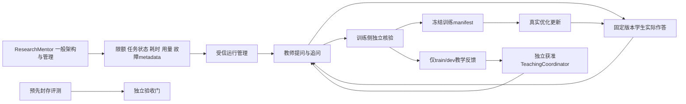

# 导师管理与独立教学协调：Student 工作流 v2

2026-10-26。**DESIGN_ONLY / STUDENT_LLM_TRAINING_NOT_RUN / QUALITY_NOT_EVALUATED**。本修订替代此前摘要的导师职责定义；旧冻结文件保留。本文只含一般架构和公开来源，不含账户状态、余额、私人路径、真实对话或训练原件。

## 职责与材料权限

导师（ResearchMentor）只做通用架构、一般方法和运行管理，可见任务状态、耗时、用量、资源和固定故障码等 operational metadata；不生成、审核或修改训练数据，不具体出题、评分，也不依据学生错误安排下一题。既有顾问会话不得批量转入训练。

独立 TeachingCoordinator 由用户独立制定，或由明确具有相应用途许可的模型服务承担；它负责具体课程、题目模板、追问树、rubric、奖励/偏好、数据筛选修改和基于 train/dev 表现的课程调整。服务许可要覆盖实际用途，不能凭“通用”标签、第三方中转或人工签名保证豁免。

| 角色 | 可发送/产生 | 可读取 | 可进入训练的内容 |
|---|---|---|---|
| ResearchMentor | 一般架构、运行限额与流程管理建议 | 受控运行 metadata；不读教学材料、学生答案或逐题错误 | 不自动回流训练材料或信号 |
| TeachingCoordinator | 获准课程、题目/追问策略、训练侧rubric与候选筛选 | 获准train/dev材料与实际回答；不读sealed eval | 仅在用途许可及独立验证通过后准入 |
| 数据教师 | 按课程出题、追问、候选答案/纠错 | 该任务授权上下文和实际学生回答 | 候选而非自动真值；模型自评不能自行验收 |
| 学生/受信runner | 固定版本实际回答、真实优化更新回执 | 当前合法问题/记忆；trainer只读获准训练manifest | 仅明确选择且正确标注的目标；执行回执不冒充答案 |
| 独立验证/评测维护者 | 核验回执、盲评和发布门结果 | 各自获准材料；sealed内容与训练角色隔离 | sealed题/答案/逐题结果不得回流训练或调参 |

`RUN → T` 只传当前授权、资源限额和流程控制，不传导师生成的具体教学内容。教师“向学生出题”与“模拟用户情境”分别标注；一次生成的虚构师生对话不能伪称学生实际作答。

## 许可来源可先走通

可以按 **DeepSeek-first** 推进，不等待四家全部齐备。[DeepSeek中文协议](https://cdn.deepseek.com/policies/zh-CN/deepseek-terms-of-use.html)和[英文协议](https://cdn.deepseek.com/policies/en-US/deepseek-terms-of-use.html)§4.2均明确涉及输入/输出用于训练其他模型、含蒸馏；服务定义涵盖API。仍需绑定实际账号/特别协议、输入权利和用途，输出不能因来自获准服务就自动视为正确或允许公开再分发。

自托管的 [DeepSeek-V4.1-Flash-1017 LICENSE](https://huggingface.co/deepseek-ai/DeepSeek-V4.1-Flash-1017/blob/main/LICENSE)为MIT，[Qwen3.8-27B LICENSE](https://huggingface.co/Qwen/Qwen3.8-27B/blob/main/LICENSE)为Apache-2.0；权重许可与托管API条款分别核验。[Alibaba国际产品条款 §4.48.1(d)(v)](https://www.alibabacloud.com/help/en/legal/latest/alibaba-cloud-international-website-product-terms-of-service-v-3-8-0)存在竞争用途限制，但不能直接套到不同地域/主体的国内产品。MiniMax按具体用途分项核实。API连通、目标型号/模态、训练用途、发布用途四类结论独立。

[OpenAI欧洲个人条款](https://openai.com/policies/eu-terms-of-use/)、[Services Agreement §3.3(e)](https://openai.com/policies/services-agreement/)及[Anthropic商业条款 D.4](https://www.anthropic.com/legal/commercial-terms)均含相关限制，具体账号/合同与有限例外不能靠角色名推定。OpenAI [2026-10-21公告的更新](https://openai.com/policies/usage-policies/)于 **2026-11-20** 生效，不能写成2026-10-26已生效，也不能把生效前日期当作规避窗口。

## 最小实施路线与质量门

下一切片 **WF0** 只做版本化 TeachingPlan/QuestionPolicy、教师能力、候选记录和来源家族registry的纯validator，使用原创合成fixture，不改Store或引入120B运行依赖。validator只证明metadata、结构与声明合同符合规则，依赖受信registry/input；不能自动发现语义抄题、隐蔽评测泄漏或认证真实授权。

独立评测维护者先封存题、答案、rubric和来源家族，之后才生成候选。train/dev可由TeachingCoordinator迭代；sealed不用于生成、筛选训练样本、prompt/超参选择或量化calibration。先接一个合格教师的有限批次，再逐项加入Qwen、M3、M2-her；每项都不继承其他型号的连通或许可资格。

| 切片 | 输出及独立验收 |
|---|---|
| WF1–2 | 有界教师↔学生实际问答、清洗/子标注/独立验证、train/dev冻结；intent先持久化，UNKNOWN submit不重放，调用/token/时间/金额分别限额 |
| WF3 | BF16 LoRA技术canary：精确模型/代码/数据/资源准入，真实optimizer step、参数delta、完整checkpoint、Adapter导出和新进程reload |
| WF4 | 原版共同baseline，等数据/token/训练预算比较DeepSeek+Qwen、加M3、加M2-her和两者；缺资格的组保留未执行，不阻塞单教师基础路线 |
| WF5–6 | BF16 merge等价、NVFP4再量化与独立复评，随后shadow、当前权限激活及合法ancestor回退 |
| WF7 | 私有运行feedback/sleep候选，前台抢占、去重与有界新attempt；不自动回灌公共Student |

Student v1起点为已后训练的 [Nemotron 3.5 Super VL BF16](https://huggingface.co/nvidia/NVIDIA-Nemotron-3.5-Super-VL-120B-A12B-BF16)。[AutoModel精确recipe](https://docs.nvidia.com/nemo/automodel/nightly/recipes-e2e-examples/nemotron-3-5-super-vl)的8×H100/约39GiB每卡仅是CORD-v2工作负载参考；不代表本项目资源已准入。[NIM指南](https://docs.nvidia.com/nim/large-language-models/latest/get-started/advanced/get-started-nemotron-3.5-super-vl.html)区分BF16 LoRA与NVFP4服务能力。TJ1小训练独立验收，Windows实际runner不自动具备Linux多卡LoRA能力。

200–500个独立评测家族、3,000–5,000个候选是规划起点，不是充分性或合格数量承诺。中文陪伴、平淡/沉默/忙碌不打扰、误解修复、偏好变化及跨会话恢复要盲评；科学、工具、来源、视觉和权限各守硬回归，不能用平均分掩盖退化，证据不足记INCONCLUSIVE。

AEMC记忆、场景、非语言背景状态与小扩散重建留在模型外部。CPU无状态/工程状态/ODE为基线，SSM/果蝇/混合及GPU/NPU按实测选用；容量压力或加速时间实验不证明十年关系。公共Student与私有记忆/个性Adapter分层，私人派生链继承私有。真实训练履历只记录受信观察，冷盘原件与经许可审查的公开副本分开；TJ0合成声明恢复不认证真实训练。
