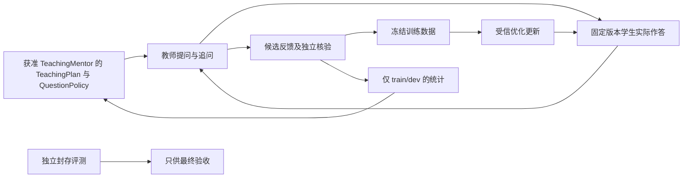

# 导师、教师与 Student 工作流：最小实施路线

2026-10-26。**DESIGN_ONLY / STUDENT_LLM_TRAINING_NOT_RUN / QUALITY_NOT_EVALUATED**。本文是可单独审阅的公开摘要，不包含账户、额度、用户路径、真实对话或私人训练履历。模型与文档信息是检索时点快照，执行时须重新固定版本。

## 角色和资产边界

- ResearchMentor 负责一般理论、文献、方法、架构和基础设施研究，依实际服务合同使用，输出不默认回流训练信号。
- TeachingMentor 负责具体提问、追问树、rubric、评分筛选及根据 train/dev 错误调整课程，由用户人工或明确获准用于这些用途的服务承担；受限闭源服务须有覆盖相应用途的授权。
- 数据教师提供获准生成的候选答案、对话、偏好对和错误样本。模型自评分可辅助筛选，不能替代工具核验、独立事实审查或盲评。
- Student 从冻结基座版本学习可复用能力。基座、通用 Student、私人实例是资产版本层；具体身份、事实、偏好、期限与撤销仍由外部权威记忆管理。私人来源及其派生数据、Adapter 和履历继承私有。
- AEMC 的记忆、场景、非语言背景状态、调度与按需重建保持模型外部服务。背景状态只影响合法候选内的注意或排序，不授予读取、训练或主动发送权限。

TeachingMentor 指导教师怎样提问：冻结考察能力、问题类型、场景条件、难度、语言、知识前提、追问节奏与停止条件。教师在约束下出题，学生产生实际回答，教师据此提出追问、反馈或纠错候选；这些候选经独立验证后才能成为训练信号。教师“向学生出题”与“生成情境/模拟用户问题”分别标注。课程调整只用 train/dev 表现和错误统计，不接收 sealed eval 的题目、答案或逐题结果。

上述是职责隔离，**不直接提供训练数据不等于当然符合防蒸馏限制**，改名或第三方中转也不自动豁免。[OpenAI 欧洲个人条款](https://openai.com/policies/eu-terms-of-use/)与[Services Agreement §3.3(e)](https://openai.com/policies/services-agreement/)均有竞争模型相关限制，后者的 Permitted Exception 有限定范围；[Anthropic 商业条款 D.4](https://www.anthropic.com/legal/commercial-terms)也有限制。具体账号、服务和书面约定未核时记 `UNVERIFIED`。OpenAI [2026-10-21 公告的更新](https://openai.com/policies/usage-policies/)明确涵盖训练材料、评分反馈和筛选等信号，但 **2026-11-20 才生效**；不能把它写成2026-10-26已生效规则，当前版本见[2025-10-29文本](https://openai.com/policies/usage-policies/revisions/2025-10-29/)。这不停止独立小训练日记或通用基础设施工作。

## 当前已知边界

Core 的 TJ0 提供有界合成声明磁盘格式与恢复，始终 `NOT_AUTHENTICATED`。TJ1 的受控小训练及独立回执按其自身验收推进；小线性模型的成功不能证明 LLM 微调、陪伴收益或生产资格。后续 general trainer 复用受信 observer、attempt、checkpoint 和阶段证据思想，不把 TJ0 的 fixture 标签改成真实执行。

目标应精确写为 [NVIDIA-Nemotron-3.5-Super-VL-120B-A12B-BF16](https://huggingface.co/nvidia/NVIDIA-Nemotron-3.5-Super-VL-120B-A12B-BF16)，即已后训练的视觉语言参考权重。官方另有 `Base-BF16`；[Super35 recipe](https://docs.nvidia.com/nemotron/latest/nemotron/super35/README.html)说明其基础阶段仍为纯文本，不能仅因名字带 VL 就替换 Student v1 的起点。权重许可标为 OpenMDW 1.1；具体 revision、代码、许可全文与依赖在执行前固定。

[AutoModel 的精确 Super VL LoRA 示例](https://docs.nvidia.com/nemo/automodel/nightly/recipes-e2e-examples/nemotron-3-5-super-vl)给出 CORD-v2 工作负载上的单节点 8×H100、约 39 GiB/GPU 参考。它是特定官方示例，不是本项目硬件、吞吐或质量验收。NVFP4 推理与 BF16 LoRA 服务能力不同，见 [NIM 指南](https://docs.nvidia.com/nim/large-language-models/latest/get-started/advanced/get-started-nemotron-3.5-super-vl.html)。

## 下一最小切片：WF0，离线合同与数据准入

先新增独立的版本化 `TeachingPlan` / `QuestionPolicy`、`TeacherCapabilityRecord`、`CandidateRecord`、`FamilySplitRegistry` 和纯 validator。复用现有权限来源；不改现有 Store schema，不启动 provider、trainer、租赁或部署。只用原创合成 fixture。字段是设计建议，须在实现前冻结；至少绑定导师指令版本、教师版本、场景/来源家族、提问追问树、学生实际回答引用、核验与纠错、停止原因及数据用途。

验收至少包括：未知版本拒绝；teacher requested/returned ID 分开；许可 unknown 不准入训练；完整来源家族连通分组；翻译/摘要/同一图像变体不得跨 train/dev/eval；sealed eval 不得流向生成提示、调参或量化校准；单批硬上限；重复同内容幂等、同身份异内容拒绝；撤销后旧 manifest 不可继续使用；空准入结果不伪称质量 PASS。

纯 validator 只验证 metadata、结构和声明来源合同，依赖受信 registry/input；它不能自动识别语义抄题、隐蔽评测泄漏，亦不能凭许可标签认证真实授权。真实内容审查与权限/合同核验保留独立门槛。

WF0 通过、且独立评测维护者已在生成前封存评测题目/答案/评分规则和来源家族后，才接一个有限的教师筛选批次。生成器只收到排除家族的受控核对结果，不读取 sealed 内容。已有 API 连通回执可复用，目标模型、视觉输入、工具行为和数据用途许可仍各自准入。预算采用冻结批次、调用/token/时间上限和独立 usage 账，不凭账户已准备推导具体模型或 GPU 可用。

## 后续切片及独立验收

| 切片 | 输出 | 独立完成条件 |
|---|---|---|
| WF1 | 有界教师生成与清洗 | intent 先落盘；未知 submit 不重放；来源、子标注、工具核验与拒收原因可追溯 |
| WF2 | 核验并冻结 train/dev，绑定预先封存的 eval | 家族与资产变体隔离；sealed 内容不变；训练进程无法读 sealed 内容 |
| WF3 | BF16 LoRA 技术 canary | 精确模型/代码/数据/资源准入；真实 optimizer step、参数差量、完整 checkpoint、Adapter 导出及新进程 reload |
| WF4 | 受控 Student 比较 | 原版共同基线；等数据/token/训练预算消融；中文陪伴盲评与科学、工具、来源、视觉硬回归分别通过 |
| WF5 | 合并与再量化 | BF16 merge 等价检查；仅 train/calibration 数据参与量化；NVFP4 独立重新加载与复评 |
| WF6 | shadow、激活及回退 | 当前权限和 lineage 合法；原子切换；失败回退到仍合法 ancestor；不以注册记录代替实际加载 |
| WF7 | 运行反馈与睡眠候选 | 反馈先成为私有候选；去重、限流、前台抢占；新训练需独立有限 attempt；不自动写公共 Student |

教师消融采用 DeepSeek+Qwen 基础、加入 M3、加入 M2-her、两者都加入的固定候选组；具体比例由开发集与合格数据决定，不按品牌预设优先级。M3 的 coding/agentic 定位不证明陪伴收益；M2-her 的角色扮演定位不证明长期关系或主观情感。

初始 200–500 个独立评测家族与 3,000–5,000 个生成候选只是规划起点。独立性、合格率和置信区间决定是否能下结论；不足记 `INCONCLUSIVE`。平淡对话、沉默、忙碌不打扰、误解修复、偏好变化、跨会话重启及撤销均纳入。模型输出、长期记忆、状态回路和量化影响分开消融。

真实训练履历只由受信执行观察与核对回执支持：训练、导出、reload、eval、量化、激活各有状态。权威原件冷存储，RAM 是缓存；公开副本须逐字段和许可审查，不能把压缩、hash 或归档恢复当真实性与质量证明。
