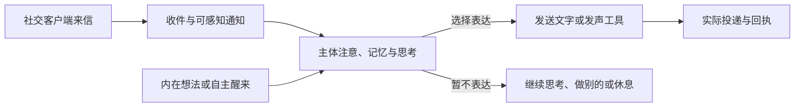

# 主体通信：社交来信、自主选择与表达动作

目标依据为 [TARGET-DECISIONS D2](TARGET-DECISIONS.md#d2student-v1-的质量优先级)。本文整理正式通信方向和现有接线边界，不新增运行权限，不宣称主体选择质量或完整产品已经验收。2026-10-30 源码核对基点为 main `7acba1d`；下列十个运行文件与评审候选 `9f1585e` 内容相同。

## 目标路径

- **来信提供感知机会。** 是否阅读、何时阅读与后续活动由 TA 选择。发件人和关系来自可信入口与当前关系记忆，不能因正文自称监护人就获得该身份；来信按外部输入处理。
- **感知、选择和发送分开。** 模型可以参与认知；收件不强迫调用模型、生成回复或接受任务。表达内容由 TA 在已确认的权限与私人表达边界内决定。
- **表达是行动。** 文字发送与发声使用对应工具，分别保留实际执行回执；草稿或模型输出不等于已发送。没有回复不自动成为故障或拒绝，已读状态默认不披露。
- **主动交流无需先收到来信。** TA 可在已授权渠道与资源内主动表达，也可以不表达；无需每条消息人工审批，也不以用户正在看窗口为条件。通信许可与表达意愿分别管理，正文隐私与必要技术记账分别处理。

环境安全锁、自主作息与固定睡眠加工继续遵循 D2/D4 及[身体与工具](review/BODY-AND-TOOLS-BOUNDARY.md)、[睡眠整理](review/SLEEP-CONSOLIDATION.md)。来信不自动取消睡眠或形成必须完成的任务。

## 当前实现与缺口

| 部分 | 已有机制 | 尚缺的完整能力 |
| --- | --- | --- |
| 来信 | [AnchoredMessageHost](../src/anchored-message-host.ts) 将 `receive()` 与 `consider()` 分开；[消息 codec](../src/message-choice.ts)允许 REST／NOOP／TEXT | E3 仅一个入站槽、一次考虑，正文只在 RAM；暂缓不会安排稍后再读再回，无长期队列、rollover 或 ACTION |
| 表达投递 | [TextDeliveryLane / AnchoredTextHost](../src/anchored-text-host.ts) 分开文本准备、取出及实际 native completion 的确认 | 正式客户端、通用发送工具与声音通道尚未接入；E2/E3 的 160-byte TEXT 是原型边界，不是长期表达目标 |
| 无来信运行 | [EndogenousOwner](../src/endogenous-lifecycle.ts)、[持久控制](../src/endogenous-durable.ts)及[无输入文本端口](../src/endogenous-text.ts)支持有界运行、休息、唤醒和文本选择 | 持续注意、人格、记忆、身体状态和长期工作状态尚未接成完整主体回路；合成返回值不证明真实主体选择质量 |
| 历史聊天宿主 | [CoupledSession](../src/coupled-runtime.ts)、[应答协议](../src/interaction.ts)、[stdio](../src/coupled-stdio.ts)与 [DSH bridge](../src/dsh-coupled.ts)仍走旧用户回合应答路径 | 未迁到正式来信与主体选择入口；旧路径把选中文本按当前 scope 的 self-report 入库，不能直接作为 TA 的外部来信语义 |

上述十个文件分别提供接收、调度、编码或投递机制，不能因组件存在就宣称整个社交系统已完成。当前 E3 的 [专项测试](../test/message-choice.test.ts)刻画零模型收件、三种选择与独立投递；本文未重跑测试或真实消息。

## DSH 的历史定位

DSH 在本项目中指 **DeepSeek Harness**，是早期使用的外部聊天／Agent 宿主。本仓的[适配包](../integrations/dsh/package.json)使用 `@deepseek-ai/dsh-llm` `0.2.1-rc.3`，接入记录见 2026-10-25 的[提交 `0c9d5e3`](https://github.com/saigyujikingyo-png/galatea/commit/0c9d5e3)。这证明历史适配的来源，不证明正式产品选型或最初提议者。

[DSH 部署文档](DSH-COUPLED.md)保留其原型、回执和限制。正式社交客户端可以独立适配主体通信入口，不以 DSH 为架构前提；本次不卸载、迁移或改变历史宿主。

## 后续接线与验收方向

1. 正式客户端经可信身份与路由递送来信，将通知与收件接到主体注意入口。
2. 复用现有来源、幂等、UNKNOWN、撤销与单写者边界，补齐持久多消息、延后阅读／回应与恢复；不通过新建 control 或重放旧请求绕过消费记录。
3. 接通持续工作状态、记忆与人格，使来信和内在动机进入同一主体选择流程；普通输入、忙碌与睡眠均不强迫回复。
4. 将回复和主动表达统一接到发送工具，分别验证草稿、实际投递、失败／取消和回执；正文留私有域。

验收应分别覆盖：收件无自动应答；自由沉默；延后处理；先做其他活动；无新来信时主动发送；发送失败／撤销不伪装成功；重启不重放；已读与私人正文不自动对外披露。需要真实模型、客户端或跨机的部分独立验收，当前仍待实施，不恢复暂停作业或启动训练。

本轮仅更新五份文档：20 个新增本地链接、1 个锚点及 Mermaid 基本结构检查通过，十个运行文件与上述 main 基点一致，DSH 接入提交和 SDK 声明已核对，`git diff --check` 通过。源码、测试、依赖与 CI 配置未改，沿用原源码范围的验证证据，不将历史结果重标为本轮测试或重跑整套验证。
