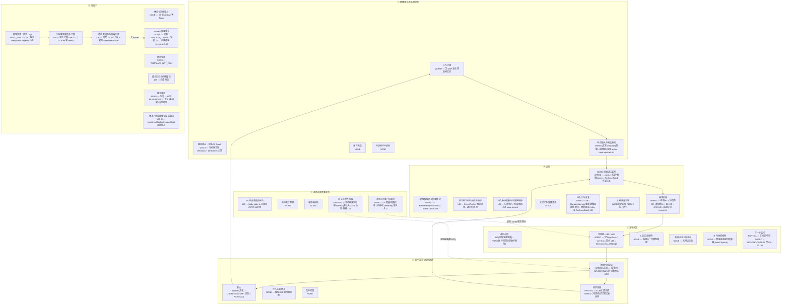

# 实际接线图（2026-10-29，main @ `7acba1d`）

这张图回答一个问题：**架构图里的每个节点，今天在哪条代码路径上？** 它不是新设计，只是对照。

标签含义（按代码可达性判定，不按文档宣称）：

| 标签 | 含义 | 判定方法 |
| --- | --- | --- |
| `WIRED` | 在线路径可达：从 `coupled-stdio` / DSH 插件入口出发的 import 闭包里，而且在人类回合里实际执行 | 静态 import 图 + 读 `coupled-runtime.ts` 的回合代码 |
| `LIB` | 有实现、有测试，但没有任何 `src` 入口把它接到在线路径；只被测试、demo 或 CLI 使用 | 只被 `test/`、`scripts/`、`src/*-demo.ts`、`src/*-cli.ts` 引用 |
| `REAL_RUN` | 不在在线路径上，但通过 CLI 在真实外部 API 上跑过（语料生产） | docs/evidence + CLI 入口 |
| `DOCS` | 只有设计文档，没有代码 | `grep` 无命中 |
| `NONE` | 文档与代码都没有，或只有拒绝桩 | — |

在线路径的 import 闭包共 35 个模块：`anchored-codec, authority-cold-format, background-state, capacity-types, contracts, coupled-runtime, coupled-stdio, curation-types, dsh-coupled, dsh-coupled-backend, dsh-coupled-host, durable-backup, durable-codec, durable-fanout, durable-memory, endogenous-durable, endogenous-lifecycle, fanout-types, http-interaction, interaction, jsonl-prior, legacy-import-types, memory-image, presence-policy, retrieval-types, runtime, safety-format, scene, scene-authority-types, scene-json, schema, schema-v2, store, validation, wire`。其余约 120 个 `src` 模块不在在线路径上。

## 图

实线是今天真正在跑的回路：人 → 文本证据入库 → 子串召回 → 一次 DeepSeek 调用 → 投递门 → DSH 原生 ACK → 反馈回库。虚线是接了一半的东西。

## 逐节点证据

| 节点 | 标签 | 证据 |
| --- | --- | --- |
| 人与环境 | WIRED | `dsh-coupled.ts:174-238` → `coupled-stdio.ts:222-236` → `coupled-runtime.ts:277-418` |
| 可信输入 | WIRED(文本) | `coupled-runtime.ts:300-304` 以 `self_report` 证据入库；`audio-input-contract.ts` 永远拒绝 |
| 硬件采集 / 外部原件 | NONE | `grep` 无 CPU/RAM/GPU 采集代码 |
| B0 身体状态 | LIB | `body-state.ts:139`；唯一引用者 `test/body-state.test.ts`；`docs/BODY-STATE.md:63` 自述 B1/B2 未实现 |
| 情感场 | WIRED | `background-state.ts:47-49,145-168,235-243,414-433`；但 `coupled-runtime.ts:309` 的 `observe` 传入 `novelty:0,socialRelevance:0,demand:0` |
| 自主节律 | PARTIAL | `coupled-runtime.ts:463-483` 单次 `setTimeout`；withdrawal 意图返回 null（`:351`） |
| 身份合同 | NONE(运行时) | 系统提示 `http-interaction.ts:52` "Return a brief helpful reply…"；人格只在 `corpus-production-baseline.ts:4-7` |
| 可替换模型 | WIRED | `coupled-stdio.ts:128,155-158` DeepSeek `deepseek-flash`；`raw-text-http.ts:110`/`http-interaction.ts:37` 接受 127.0.0.1 但无配置 |
| L / 工作状态 / R | NONE | 每回合上下文 = 当前文本 + ≤6 条记忆（`dsh-coupled.ts:218` 取前 256 字符做查询）；无历史；模型记忆建议丢弃（`coupled-runtime.ts:404-411`） |
| 下一步选择 | PARTIAL | REST/NOOP/TEXT 只在 `endogenous-lifecycle.ts:64-85`，由 `anchored-*-host` 驱动，无 `src` 入口 |
| AEMC 底座 | WIRED | `store.ts:195-229`（代际/同意/祖先核验）、`:720-772`（撤销级联） |
| 持久化 | WIRED(M2) | `coupled-stdio.ts:143-150` 构造 `DurableMemory`，无 `expectedHead`；`store.ts:155` 每次变更 `serialize()` 整库 |
| AnchoredVault | LIB | 引用者只有 `anchored-text-host`、`anchored-message-host`、`endogenous-durable`、`safety-segment` |
| 召回 | WIRED | `store.ts:668-681` `ORDER BY created_at` 升序取前 `limit`；`coupled-runtime.ts:45-60` 正则关键字重排 |
| AR0 / BM25 | LIB / research | `retrieval.ts:22-24,148-168`；`research/retrieval-baseline/bm25.ts` 无 `src` 引用 |
| 行动提交门 | WIRED(文本) | `coupled-runtime.ts:282-290`（幂等）、`durable-memory.ts:49-57,171-183`（单写锁、UNKNOWN） |
| 表达 | WIRED(文本)/LIB(语音) | `speech-controller.ts:23,47`："No such implementation ships here" |
| 工具网关 | NONE | `http-interaction.ts:103-105` 拒绝工具调用 |
| 教学/语料 | REAL_RUN | `corpus-production-runner.ts`、`corpus-qa-runner.ts`；`docs/evidence/CORPUS-QUALITY-AUDIT-20261028.md` |
| Student / 评测 / 激活 | NONE / LIB 桩 | `corpus-teacher-types.ts:6`；`scripts/tj1-trainer.py:97-142`；`store.ts:791-820` |

## 对照后最短的结论

1. 在线回路是"记忆 + 一次调用 + 投递门"，③ 认知几乎为空，②/⑤/⑥ 的大部分是库或文档。
2. 最大的单点：M2 路径与 AnchoredVault 路径并存，运行时用的是前者。
3. 把 `LIB` 接进在线路径，比再加任何新 `LIB` 都更接近架构图。
