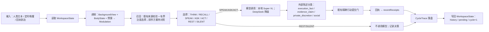

# 最小认知环设计草案（B）

目标：把架构图 ③ 里仍为 NONE 的节点——有限共享工作状态、下一步选择、身份合同进入运行时——以最小代价接到现有在线路径上，不推翻 store／投递门／DurableMemory。接口合同见 `src/cognitive-loop-contracts.ts`（仅类型）。

2026-10-30 主控处置：本文仍是设计草案，未接入运行时。先收口 #35 的布局故障与容量验收，再审定在线闭环切片。BM25 替换、模型角色调整与人格目标变更均未由本草案批准；#37 格式化另择集成窗口。

## 1. 一个认知周期

一个周期内最多一次模型调用（THINK 可再触发一次，受预算限制）；REST／SILENT 是合法结果，不是故障。

## 2. 各节点的最小实现

### 2.1 WorkspaceState
- 存放位置：Store 的一个新 memory kind 或独立表 `workspace`（每个 scope 一行，JSON，≤64 KiB）；每周期读一次、写一次，走现有事务。
- `history`：有界环（建议 32 轮或 16K token，先到先裁），只存外部可见文本与回执 ID；思考内容不进历史。
- `attention`：本周期纳入提示的记忆（≤N 条），由召回 + 调制里的 `verbosity`／`riskAversion` 决定 N。
- `pending`：承诺过的回复、等待中的工具回执、未完成的 followup。这是"主体记得自己答应过什么"的最小形式。
- `history`／`attention` 中的正文副本不等于持续获准的来源。每次进入提示、召回或投递前，按既有 Store 合同复核 revision、scope 代际、当前许可、撤销与 TTL；不能复核就拒绝使用，并按当前保留权限处置缓存正文。保存 ref 或通过一次历史校验不能绕过后续复核。

### 2.2 调制（② → ③ 的唯一通道）
- 输入：`BackgroundView`（已有）、`BodyStateOwner` 的读数（现为 LIB，需接入）、预算视图。
- 输出：五个有界参数 + provenance。规则：调制只改变候选的分数，不直接决定动作；每条贡献写进 `ChoiceDecision.proposals[].modulationContribution`。
- 先用手写线性映射（例如 `withdrawal↑ → restBias↑, proactiveThreshold↑`），果蝇／GRU／SSM 作为可替换后端对照，不作默认。
- 修复现有缺陷：`coupled-runtime.ts:309` 的 `observe` 要传真实特征（消息长度／新鲜度、是否提问、与上轮的相似度），而不是全 0。

### 2.3 召回
- 暂不直接替换排序器。[既有固定 16 查询对照](../../research/retrieval-baseline/README.md#fixed-cohort-result-and-decision)中，AR0／BM25 的 Recall@3 为 95.83%／66.67%，unknown 查询返回候选为 0/4／2/4；该小型合成集不支持替换 AR0，也不证明 BM25 普遍更差。在线 `store.search` 与 AR0 不是同一路径，在线替换须另做匹配工作负载的对照。
- 时间排序和排除当前输入应作为独立、可比较的候选；入库、来源绑定与撤销校验保持现有合同，不仅凭“最新优先”或 BM25 名称认定质量改善。
- 召回结果带 `SourceRef`，供陈述的 `supports` 引用。

### 2.4 选择节点
- 候选集固定为七种；每个候选一个分数 = 基础分（规则）+ 调制贡献 + 约束项。约束项来自现有机制：预算（`RequestBudget`）、暂停／撤销（`CoupledSession` 的 pause）、通信窗口（E2 的 `TextCommunicationPermission`）。
- 第一版可以不用模型做选择：规则打分即可；模型只在 SPEAK／ASK／THINK 时被调用。这样 REST／SILENT 零成本，也避免"为了选择而调用模型"。
- 每个决策产出 `ChoiceDecision` 并进入 `CycleTrace`。

### 2.5 身份合同进入运行时
- 系统提示 = `persona.publicProfile` + `hardRules` 的自然语言版 + 工作状态摘要（pending、最近回执的事实）+ `discretion` 的说明。
- `privateInstance` 只在本地端点启用；任何云端降级调用不携带私有实例层。
- 本周期实际采用的人格 version 与 digest 写进每条 `CycleTrace.persona`，便于评测分层；不在 Trace 中复制私有实例层正文。

### 2.6 模型端点
- `ModelEndpoint[]`：`super-vl-local`（primary，`http://127.0.0.1:8000`，vision/video，thinking off/medium/high，latencyBudgetMs 按回合类型：闲聊 8 s、规划 60 s）与 `deepseek-cloud`（fallback，仅文本）。
- `RawTextPort`／`HttpInferenceAdapter` 已接受回环端点，只需配置与一次适配（OpenAI 兼容格式、`reasoning-parser nemotron_v3` 的思考字段提取）。
- 超过延迟预算：本周期退化为 SILENT 并记录，不重试。

### 2.7 陈述与回执
- 模型输出先切成 `ExternalStatement[]`，由规则或模型自标 `honestyClass`；`execution_fact`／`evidence_claim` 必须引用回执或来源，否则该句不得投递（降级为改写或删除）。
- 这就是"内部真实、外部表达"分离的落点：回执是账本事实；`private_discretion`／`social` 类陈述由主体裁量。

### 2.8 CycleTrace 与评测
- 每周期一条 JSONL，字段见 `CycleTrace`；不含私有实例层正文，含 `rationale`（私有，本地）。
- `ChoiceProposal.rationale` 是决策说明，不承载原始 `ModelResponse.thinking`。后者仅为可选瞬时结果，本最小合同不将其写入 Trace、历史或云端请求。Trace 是评测证据，不能代替当前权威来源与许可复核。
- `EvaluationProbe` 的五个硬门以 trace 流为输入离线运行；任何一项 FAIL 都阻止适配器激活与人格版本升级。

## 3. 接入顺序（每步可单独验收）

1. `WorkspaceState` + 历史环 + `CycleTrace`（不改行为，只增记录）。
2. 人格进入系统提示；云端降级不带私有层。
3. 修 `observe` 输入；对照召回排序与当前输入排除方案，凭结果决定是否替换。
4. 选择节点（规则打分）；REST／SILENT 可用；主动投递改走选择节点。
5. 本地 Super VL 端点为 primary。
6. 调制接入 BodyState；消融实验（开／关调制）对比盲评。
7. 五个评测探针跑在 trace 流上。

## 4. 不做的事

- 不在这一轮引入 L/R 双模型：先让一个显式通道成立，再决定 R 侧是否需要独立小模型。
- 不把身份、个人事实写进权重。
- 不为选择节点再建一套账本或持久层：决策只进 trace，执行仍走既有门。
